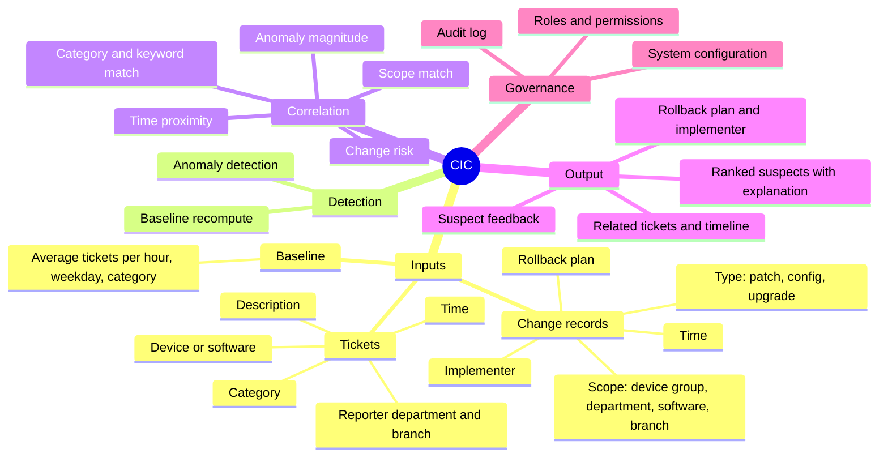
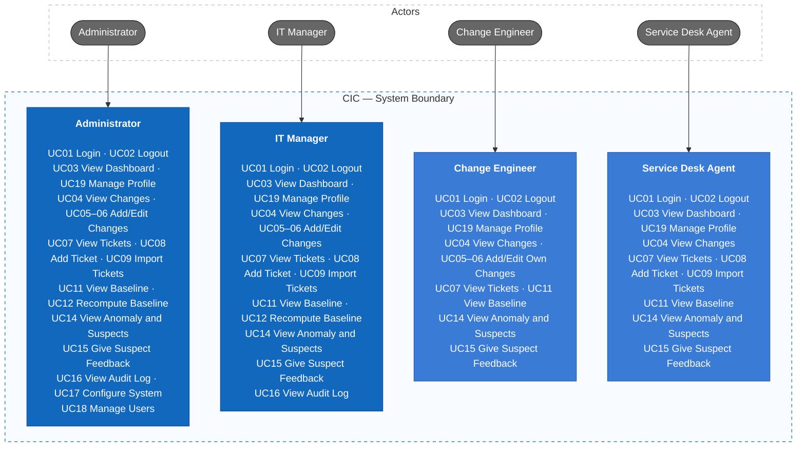
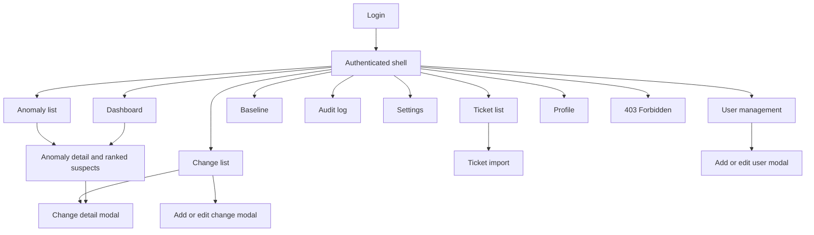

# Change-Incident Correlation (CIC)

Change-Incident Correlation helps IT teams answer one question when tickets suddenly spike: **"Which recent change is most likely the cause?"** It brings together change records, tickets, and historical baselines, detects abnormal ticket volume, and ranks the recent changes as "suspects" with an explainable score, so the service desk no longer depends on a few experienced people to connect the dots.

> **Real example:** On Tuesday at 22:00, IT applies a Windows patch to the Accounting department. On Wednesday morning, 14 "cannot print" tickets arrive. CIC detects the spike against the baseline, links it to the patch, and puts that change at the top of the suspect list together with its rollback plan and the engineer who applied it.

## 1. Requirements — INVEST, Use Cases, and Acceptance Criteria

Requirements define what CIC must do, who uses it, the value delivered, and the observable conditions of success. User stories are reviewed with INVEST and mapped to use cases.

### 1.1 Product mind map



### 1.2 INVEST requirements

The V1 backlog includes 19 user stories. These stories cover login, change and ticket management, ticket import, baseline, anomaly and suspect review, feedback, audit log, configuration, user management, personal profile, and ITSM API ingestion.
Before a user story is ready for development, it is checked using the INVEST criteria.

| Criterion       | Meaning in CIC                                                                                                      |
| --------------- | ------------------------------------------------------------------------------------------------------------------- |
| **Independent** | Each story should provide a clear feature and depend on other stories only when necessary.                          |
| **Negotiable**  | The UI and technical implementation can change as long as the main goal and permission rules stay the same.         |
| **Valuable**    | Each story should provide value to the user or the business.                                                        |
| **Estimable**   | Roles, inputs, outputs, dependencies, and important failure outcomes are documented.                                |
| **Small**       | Each story covers one primary capability and can be divided into API, application, persistence, UI, and test tasks. |
| **Testable**    | Every story maps to observable outcomes and expected authorization, validation, and error behavior.                 |

```text
US01–US02   Authentication and session
US03        Incident dashboard
US04–US06   Change management
US07–US09   Ticket management and import
US10–US11   Baseline
US12–US14   Anomaly, ranked suspects, and feedback
US15        Audit log
US16        System configuration
US17–US18   User management and personal profile
US19        ITSM API ingestion
```

The complete story-level review is maintained in [INVEST Requirements](docs/05-invest-requirements.md).

### 1.3 Use cases



Two system actors are not shown: the **ITSM system** (UC10, pushes tickets and changes through the API) and the **background processor** (UC13, detects anomalies and ranks suspects).

For detailed actors, permissions, and business flows, see [Actors, roles, and use cases](docs/03-use-cases.md).

### 1.4 Roles and permissions

| Capability                       | Admin | IT Manager | Change Engineer   | Agent     |
| -------------------------------- | ----- | ---------- | ----------------- | --------- |
| View dashboard, anomalies, suspects | Yes | Yes        | Yes               | Yes       |
| View changes and tickets         | Yes   | Yes        | Yes               | Yes       |
| Create changes                   | Yes   | Yes        | Yes               | No        |
| Edit changes                     | Yes   | Yes        | Own records only  | No        |
| Create / import tickets          | Yes   | Yes        | No                | Yes       |
| View baseline                    | Yes   | Yes        | Yes               | Yes       |
| Recompute baseline               | Yes   | Yes        | No                | No        |
| Give suspect feedback            | Yes   | Yes        | Yes               | Yes       |
| Audit log                        | Yes   | Yes        | No                | No        |
| System configuration             | Yes   | No         | No                | No        |
| User management                  | Yes   | No         | No                | No        |

The backend must enforce RBAC and the own-record policy; hiding frontend controls serves UI/UX only.

## 2. Information Architecture, Screen Hierarchy, and UI/UX

The information architecture organizes the authenticated workspace by business capability. Screen permissions and navigation follow the role matrix, while loading, empty, validation, error, saving, and success states are defined consistently.

### 2.1 Information architecture

```text
Public
└── Login

Authenticated
├── Dashboard
├── Anomalies
├── Changes
├── Tickets
├── Baseline
├── Audit
├── Settings
├── Users
├── Profile
└── Forbidden
```

### 2.2 Screen hierarchy

Login leads to the authenticated shell. The shell owns navigation to feature pages; change, ticket, and user create/edit interactions use feature-owned modals. The anomaly detail page links to the suspect change detail. Unauthorized navigation resolves to the Forbidden screen.



Detailed screen IDs, user flows, screen states, accessibility rules, and use-case mappings are maintained in [Information Architecture](docs/04-information-architecture.md).

### 2.3 Current UI prototype

No UI prototype exists yet. Screens will be designed from the [screen inventory](docs/04-information-architecture.md#3-screen-inventory) in a later phase.

## Documentation

- Requirements: [Scope](docs/01-scope.md), [Features](docs/02-features.md), [INVEST backlog](docs/05-invest-requirements.md).
- Actors and use cases: [Actors, roles, and use cases](docs/03-use-cases.md).
- UI/UX: [Information architecture](docs/04-information-architecture.md).

## Project Progress

- [x] Define scope, goals, and user roles
- [x] Write the feature list and use cases
- [x] Write user stories following INVEST
- [x] Design the information architecture and screen permissions
- [x] Design the screen hierarchy, task flows, and UI states
- [ ] Write acceptance criteria and business rules
- [ ] Write non-functional requirements
- [ ] Design the baseline, anomaly detection, and suspect ranking algorithms
- [ ] Design the C4 System Context, Container, and Component views
- [ ] Design the database schema and data relationships
- [ ] Write the API documentation in OpenAPI 3.0
- [ ] Design class diagrams and sequence diagrams
- [ ] Build the UI prototype for each role
- [ ] Build the backend and connect the frontend to the API
