# Change-Incident Correlation (CIC)

Change-Incident Correlation helps IT teams answer one question when tickets suddenly spike: **"Which recent change is most likely the cause?"** It brings together change records, tickets, and historical baselines, detects abnormal ticket volume, and ranks the recent changes as "suspects" with an explainable score, so the service desk no longer depends on a few experienced people to connect the dots.

> **Real example:** On Tuesday at 22:00, IT applies a Windows patch to the Accounting department. On Wednesday morning, 14 "cannot print" tickets arrive. CIC detects the spike against the baseline, links it to the patch, and puts that change at the top of the suspect list together with its rollback plan and the engineer who applied it.

## 1. Requirements — INVEST, Use Cases, and Acceptance Criteria

Requirements define what CIC must do, who uses it, the value delivered, and the observable conditions of success. User stories are reviewed with INVEST and mapped to use cases.

### 1.1 Product mind map


### 1.2 INVEST requirements

The V1 backlog includes 23 user stories. These stories cover login, change and ticket management, ticket import, baseline, anomaly and suspect review, feedback, audit log, configuration, user management, personal profile, ITSM and log ingestion, error-log review, and AI-suggested resolutions.
Before a user story is ready for development, it is checked using the INVEST criteria.

| Criterion       | Meaning in CIC                                                                                                      |
| --------------- | ------------------------------------------------------------------------------------------------------------------- |
| **Independent** | Each story should provide a clear feature and depend on other stories only when necessary.                          |
| **Negotiable**  | The UI and technical implementation can change as long as the main goal and permission rules stay the same.         |
| **Valuable**    | Each story should provide value to the user or the business.                                                        |
| **Estimable**   | Roles, inputs, outputs, dependencies, and important failure outcomes are documented.                                |
| **Small**       | Each story covers one primary capability and can be divided into API, application, persistence, UI, and test tasks. |
| **Testable**    | Every story maps to observable outcomes and expected authorization, validation, and error behavior.                 |

```text
US01–US02   Authentication and session
US03        Incident dashboard
US04–US06   Change management
US07–US09   Ticket management and import
US10–US11   Baseline
US12–US14   Anomaly, ranked suspects, and feedback
US20–US21   Suggested resolution and its confirmation
US22–US23   Error logs: ingestion and review
US15        Audit log
US16        System configuration
US17–US18   User management and personal profile
US19        ITSM API ingestion
```

The complete story-level review is maintained in [INVEST Requirements](docs/05-invest-requirements.md).

### 1.3 Use cases

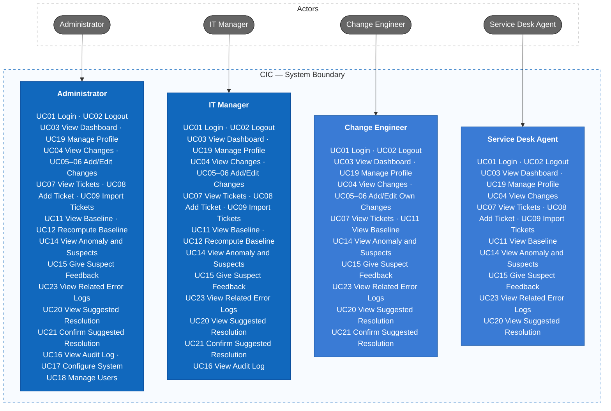

Three system actors are not shown: the **ITSM system** (UC10, pushes tickets and changes through the API), the **log source** (UC22, pushes error logs through the API), and the **background processor** (UC13, detects anomalies, ranks suspects, analyzes related logs, and drafts suggested resolutions).

For detailed actors, permissions, and business flows, see [Actors, roles, and use cases](docs/03-use-cases.md).

### 1.4 Roles and permissions

| Capability                       | Admin | IT Manager | Change Engineer   | Agent     |
| -------------------------------- | ----- | ---------- | ----------------- | --------- |
| View dashboard, anomalies, suspects | Yes | Yes        | Yes               | Yes       |
| View changes and tickets         | Yes   | Yes        | Yes               | Yes       |
| Create changes                   | Yes   | Yes        | Yes               | No        |
| Edit changes                     | Yes   | Yes        | Own records only  | No        |
| Create / import tickets          | Yes   | Yes        | No                | Yes       |
| View baseline                    | Yes   | Yes        | Yes               | Yes       |
| Recompute baseline               | Yes   | Yes        | No                | No        |
| Give suspect feedback            | Yes   | Yes        | Yes               | Yes       |
| View related error logs          | Yes   | Yes        | Yes               | Yes       |
| View suggested resolution        | Yes   | Yes        | Yes               | Yes       |
| Confirm / reject suggested resolution | Yes | Yes     | Yes               | No        |
| Audit log                        | Yes   | Yes        | No                | No        |
| System configuration             | Yes   | No         | No                | No        |
| User management                  | Yes   | No         | No                | No        |

The backend must enforce RBAC and the own-record policy; hiding frontend controls serves UI/UX only.

### 1.5 Acceptance criteria, business rules, and non-functional requirements

Every use case has observable acceptance criteria (`AC-UC01`–`AC-UC23`), written to become API and UI tests. Business rules (`BR-001`–`BR-021`) fix the decisions the code must follow, and non-functional requirements set measurable targets.

| Area | Key rules and targets |
|---|---|
| Detection | Anomaly when count > mean + 3 × std dev (configurable); detected within 2 intervals (default 30 min) |
| Ranking | Changes started within 48 h before the spike (not `SCHEDULED`); score 0–100 from five weighted factors; High ≥ 70, Medium ≥ 40 |
| AI suggestion | Every cause cites evidence; Flexible (LLM-knowledge) steps keep the label Hypothesis; LLM failure never changes the ranking |
| Security & privacy | JWT 30 min; 5 failed logins / 15 min → `429`; logs masked before storage and before the LLM; secrets never logged |
| Performance | Reads P95 ≤ 500 ms; writes ≤ 800 ms; dashboard and anomaly detail ≤ 2 s; 50 concurrent users |

Details: [Acceptance Criteria](docs/08-acceptance-criteria.md), [Business Rules](docs/requirements/business-rules.md), [Non-Functional Requirements](docs/requirements/non-functional-requirements.md).

## 2. Information Architecture, Screen Hierarchy, and UI/UX

The information architecture organizes the authenticated workspace by business capability. Screen permissions and navigation follow the role matrix, while loading, empty, validation, error, saving, and success states are defined consistently.

### 2.1 Information architecture

An information architecture is more than a list of pages. CIC defines it through four systems — organization, labeling, navigation, and hierarchy — following the classic IA model (Rosenfeld & Morville).

**Organization scheme.** Pages are grouped by the *job the user is doing*, not by database table: **Monitor** (what is wrong now), **Records** (the data that explains it), **Analysis** (what normal looks like), and **Administration** (who and how the system is configured). Inside a group, items are organized by object (Change, Ticket, Anomaly).

**Site map.** Level 0 is the product, level 1 is a navigation group, level 2 is a page, level 3 is a section or modal inside a page.

```mermaid
flowchart TB
    CIC(["CIC"])
    CIC --> Public["Public"]
    CIC --> Shell["Authenticated workspace<br/>(sidebar + topbar)"]
    CIC --> Sys["System page"]
    Public --> Login["Login"]
    Sys --> Forbidden["403 Forbidden"]

    Shell --> Monitor["MONITOR"]
    Shell --> Records["RECORDS"]
    Shell --> Analysis["ANALYSIS"]
    Shell --> Admin["ADMINISTRATION"]
    Shell --> Utility["UTILITY (topbar)"]

    Monitor --> Dash["Dashboard"]
    Dash --> D1["Open anomalies"]
    Dash --> D2["Tickets versus baseline"]
    Dash --> D3["Top suspects"]
    Monitor --> Anom["Anomalies"]
    Anom --> A1["Anomaly list"]
    Anom --> A2["Anomaly detail"]
    A2 --> A3["Ranked suspects<br/>score + explanation"]
    A2 --> A4["Related tickets"]
    A2 --> A5["Timeline"]
    A2 --> A8["Related error logs"]
    A2 --> A6["Suspect feedback"]
    A2 --> A7["Suggested resolution<br/>standard + hypothesis"]

    Records --> Chg["Changes"]
    Chg --> C1["Change list"]
    Chg --> C2["Add / edit change<br/>(modal)"]
    Chg --> C3["Change detail<br/>(modal)"]
    Records --> Tkt["Tickets"]
    Tkt --> T1["Ticket list"]
    Tkt --> T2["Add ticket<br/>(modal)"]
    Tkt --> T3["Import<br/>preview + history"]

    Analysis --> Base["Baseline"]
    Base --> B1["Baseline versus actual"]
    Base --> B2["Recompute"]

    Admin --> Audit["Audit log"]
    Admin --> Set["Settings"]
    Set --> S1["Thresholds and tracing window"]
    Set --> S2["Ranking weights"]
    Set --> S3["Categories and scope mappings"]
    Admin --> Usr["Users"]
    Usr --> U1["Add / edit user<br/>(modal)"]

    Utility --> Prof["Profile"]
    Prof --> P1["Account"]
    Prof --> P2["Security"]
    Prof --> P3["Roles and permissions"]
    Utility --> U2["Time range and time zone"]
    Utility --> U3["Log out"]

    classDef root fill:#222,color:#fff,stroke:#000
    classDef group fill:#1168bd,color:#fff,stroke:#0b4f9e
    classDef page fill:#dbeafe,color:#111,stroke:#3a7bd5
    classDef leaf fill:#fff,color:#111,stroke:#bbb
    class CIC root
    class Monitor,Records,Analysis,Admin,Utility group
    class Dash,Anom,Chg,Tkt,Base,Audit,Set,Usr,Prof page
    class D1,D2,D3,A1,A2,A3,A4,A5,A6,A7,A8,C1,C2,C3,T1,T2,T3,B1,B2,S1,S2,S3,U1,U2,U3,P1,P2,P3,Login,Forbidden leaf
```

**Navigation model.**

| Layer | Where | Content |
|---|---|---|
| Global | Sidebar | The four groups and their level-2 pages; groups with no permitted page are hidden |
| Utility | Topbar | Profile, time range / time zone, logout |
| Local | Tabs inside a page | Anomaly detail (Suspects · Related tickets · Timeline), Settings, Profile |
| Contextual | Links inside content | Suspect → change detail; change detail → anomalies it is suspected in; ticket → anomaly it belongs to |

**Labeling.** Labels use the user's vocabulary and one term per concept: *Change* (never "modification"), *Ticket*, *Anomaly*, *Suspect*, *Baseline*. A suspect always shows its score as a number plus a High / Medium / Low label.

**Role scope.** Every level-2 page declares which roles can see it (see [page permissions](docs/04-information-architecture.md#page-permissions)). Unauthorized pages are not rendered in the sidebar, and direct access resolves to 403.

### 2.2 Screen hierarchy

Login leads to the authenticated shell. The shell owns navigation to feature pages; change, ticket, and user create/edit interactions use feature-owned modals. The anomaly detail page links to the suspect change detail. Unauthorized navigation resolves to the Forbidden screen.

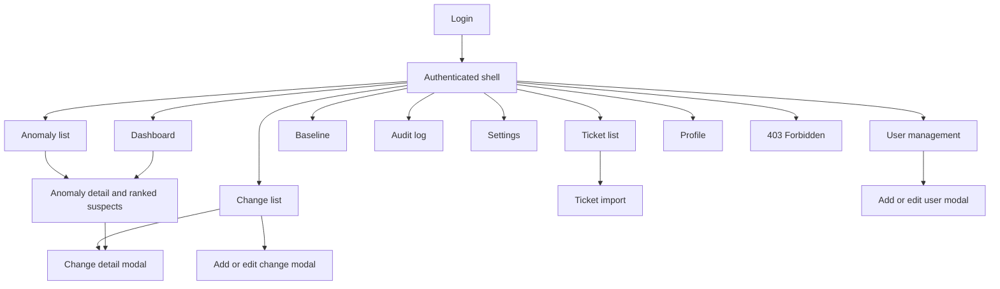

Detailed screen IDs, user flows, screen states, accessibility rules, and use-case mappings are maintained in [Information Architecture](docs/04-information-architecture.md).

### 2.3 Current UI prototype

No UI prototype exists yet. Screens will be designed from the [screen inventory](docs/04-information-architecture.md#3-screen-inventory) in a later phase.

## 3. C4 Architecture

This README presents C1–C3. Responsibilities, architecture rules, and the component catalog are maintained in the architecture documentation directory.

### C1 — System Context

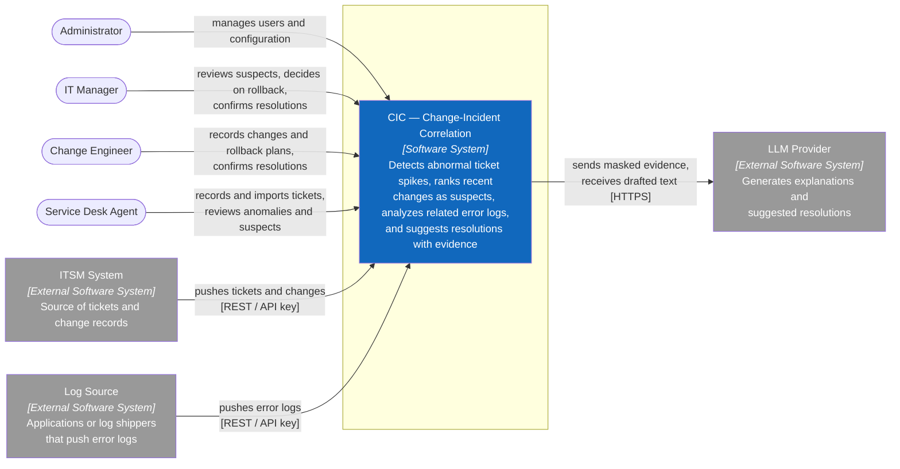

### C2 — Container

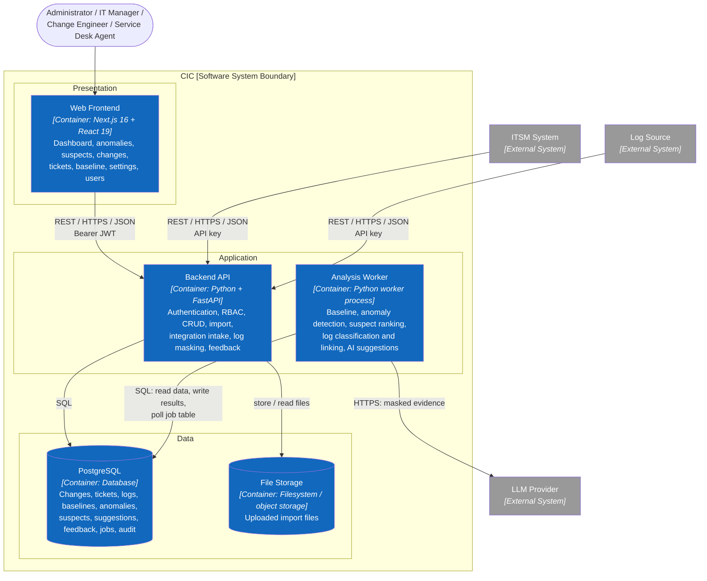

The Backend API and the Analysis Worker communicate through a job table in PostgreSQL, not a message broker. Logs are masked by the Backend API on receipt; only the Analysis Worker calls the LLM Provider, after the suspicion score is computed.

### C3 — Component

#### C3.1 Backend API

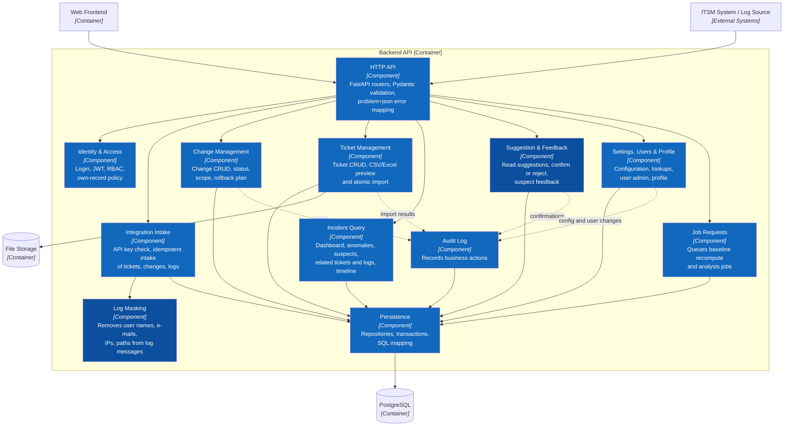

#### C3.2 Analysis Worker

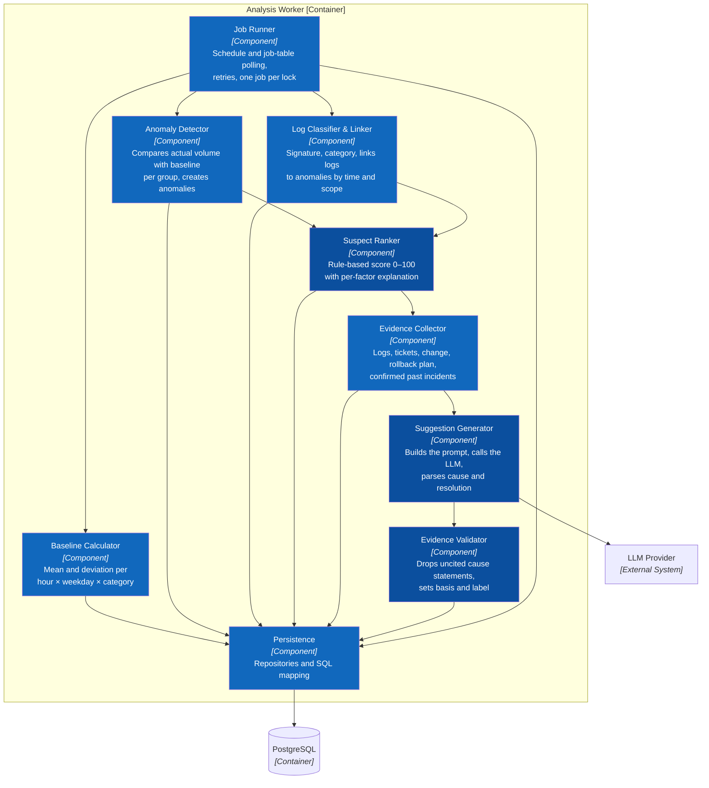

### AI pipeline and knowledge graph

How the AI part goes from input to output. Detection and ranking are rule-based; the LLM only reasons over evidence retrieved from the knowledge graph, and every cause it states must cite that evidence.

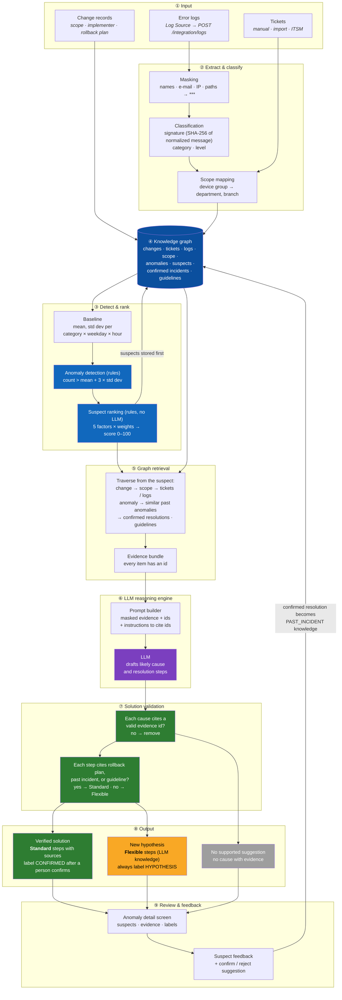

The knowledge graph links every entity CIC knows. In V1 it is stored in PostgreSQL (rows are nodes, foreign keys and link tables are edges) and traversed with SQL joins; confirmed resolutions flow back into it as past incidents.

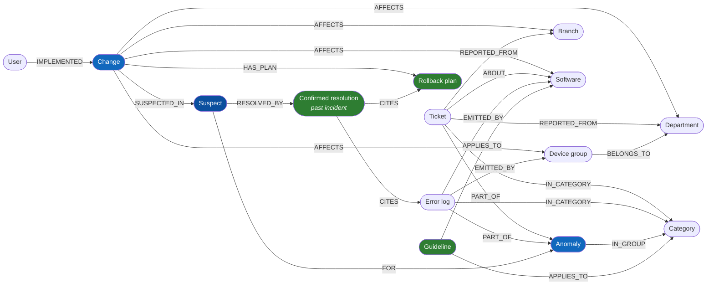

Retrieval paths, node/edge-to-table mapping, and the printer walkthrough: [AI Pipeline and Knowledge Graph](docs/architecture/ai-pipeline.md).

Complete documentation: [C4 Architecture](docs/architecture/c4/README.md).

## 4. Database Diagrams and OpenAPI 3.0 Contract

This step defines the persistence contract (PostgreSQL) and the HTTP contract (OpenAPI) between the Web Frontend, external systems, and the backend.

### 4.1 Database diagrams

The PostgreSQL model links the three inputs (changes, tickets, error logs) to detection (baselines, anomalies), ranking (suspects), and AI suggestions with cited evidence. Scope values (department, branch, software, device group, category) are shared lookup tables, so scope matching compares ids rather than free text.

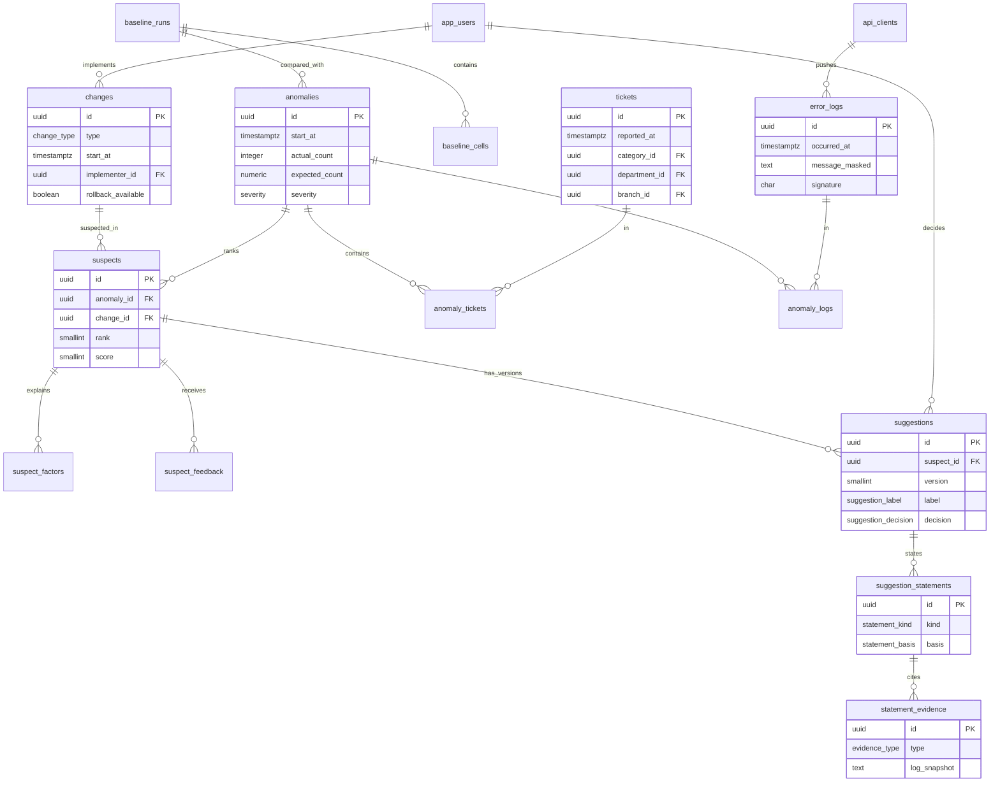

Key rules enforced by the schema: a cause statement is always evidence-based, each evidence row cites exactly one thing, `CONFIRMED` requires a person's decision, ticket import is atomic, and integration intake is idempotent by `(source_client_id, external_id)`. Error logs keep only the masked message and are deleted after the retention period; evidence keeps a masked snapshot.

See the [detailed database diagram](docs/DATABASE.md), [data model](docs/06-data-model.md), and [PostgreSQL schema](src/database/cic.sql).

### 4.2 OpenAPI 3.0 API documentation

The REST contract is defined with OpenAPI 3.0 and derived from the use cases and screens. It covers authentication, dashboard, anomalies and ranked suspects, related error logs, suggested resolutions, changes, tickets and import, baseline, audit log, settings, users, profile, and ITSM and log ingestion.

- Contract: [`docs/api/openapi.yaml`](docs/api/openapi.yaml)
- Conventions, role per operation, and screen-to-API mapping: [API documentation](docs/api/README.md)

## 5. Frontend and Backend Folder Structures

The frontend uses **Next.js 16 + React 19 + TypeScript**. The backend uses **Python + FastAPI**, organized by module, with a separate AI package; the API and the worker share one codebase.

### 5.1 Repository layout

```text
practise/
├── src/
│   ├── frontend/                 # Next.js 16 + React 19 (Web Frontend)
│   ├── backend/                  # FastAPI API + Analysis Worker, one codebase
│   └── database/cic.sql          # PostgreSQL schema
├── docs/                         # Requirements, IA, C4, data model, API, folder structure
├── .gitignore                    # Ignores .env files, keeps .env.example
├── CLAUDE.md                     # Rules for coding agents
└── README.md
```

### 5.2 Target Next.js structure

```text
src/frontend/
├── app/                 # App Router: (public)/login, (workspace)/dashboard, anomalies/[anomalyId],
│                        # changes, tickets/import, baseline, audit, settings, users, profile, forbidden
├── features/            # auth, dashboard, anomalies, suggestions, changes, tickets,
│                        # baseline, audit, settings, users, profile (components/, hooks/, api.ts)
├── components/          # Shared UI; ui/ holds shadcn/ui components
├── lib/                 # api-client, api-types (from OpenAPI), formatting, utils (cn)
├── proxy.ts             # Login and role redirects (Next.js 16 name for middleware)
├── tests/               # Vitest + Testing Library
├── components.json      # shadcn/ui configuration
├── .env.example
└── package.json         # Tailwind CSS 4, shadcn/ui, react-hook-form + zod, TanStack Query/Table
```

```text
app/ route → feature component → feature hook → feature api.ts → api-client → REST API
```

### 5.3 Target FastAPI modular structure

```text
src/backend/
├── app/
│   ├── main.py  worker.py  api_router.py
│   ├── core/            # config, database, security, container (DI), deps, errors
│   ├── modules/         # auth, users, settings, changes, tickets, logs, integration,
│   │   └── <module>/    # baseline, anomalies, suggestions, dashboard, audit, jobs
│   │       ├── router.py        # controller, exposed through api_router
│   │       ├── service.py       # business logic, depends on interfaces
│   │       ├── repository.py    # Protocol + SQLAlchemy implementation
│   │       ├── models.py  schemas.py  dependencies.py
│   └── ai/              # LLMClient interface, llm_client, masking, evidence, generator, validator
├── tests/               # fakes/, modules/, ai/
├── alembic/
├── .env.example
├── requirements.txt     # runtime dependencies (pinned)
├── requirements-dev.txt # + pytest, ruff, mypy
└── Dockerfile           # one image: api or worker
```

```text
api_router → module/router → module/service → repository interface → PostgreSQL
worker → module/service or ai/ → repository → PostgreSQL
```

Modules call each other only through services; implementations are injected from `core/container.py`, so tests swap them for fakes.

Module ownership, rules, and environment variables: [Target Folder Structure](docs/07-folder-structure.md).

## 6. Detailed Class and Sequence Design

Detailed design derives from the C4 components (section 3), the database and OpenAPI contracts (section 4), and the module structure (section 5). Names are Python classes inside the FastAPI modules; these are target design views.

### 6.1 C4 Level 4 — Code collaboration

The two core features: **Suspect Ranking** (rule-based, no LLM) and **Suggested Resolution** (LLM with evidence validation). Both run in the worker; users read the results through the API.

#### L4.1 Suspect Ranking

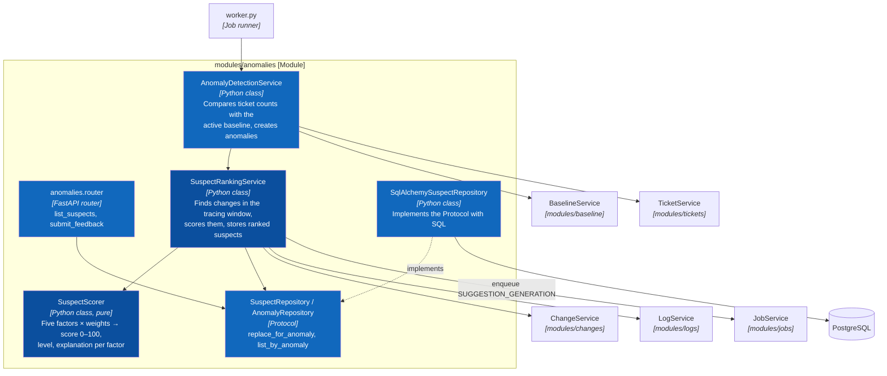

#### L4.2 Suggested Resolution

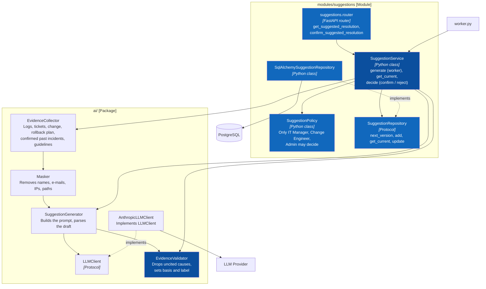

Source: [C4 Level 4 — Code](docs/architecture/c4/04-code.md)

### 6.2 Core class diagrams

#### 1. Change Management

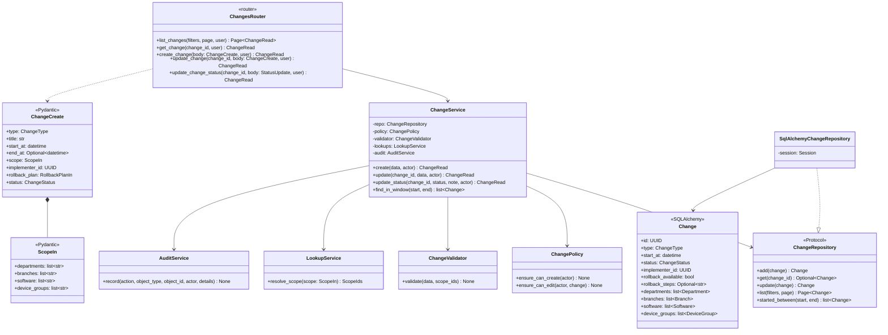

#### 2. Suspect Ranking

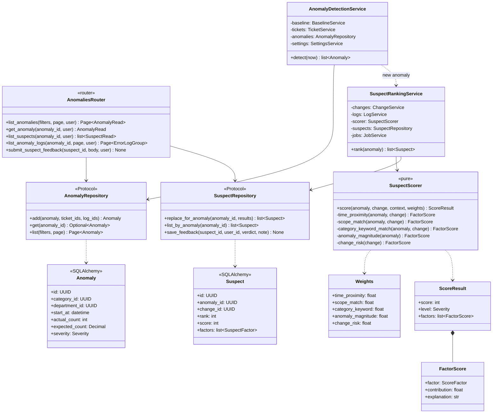

#### 3. Suggested Resolution

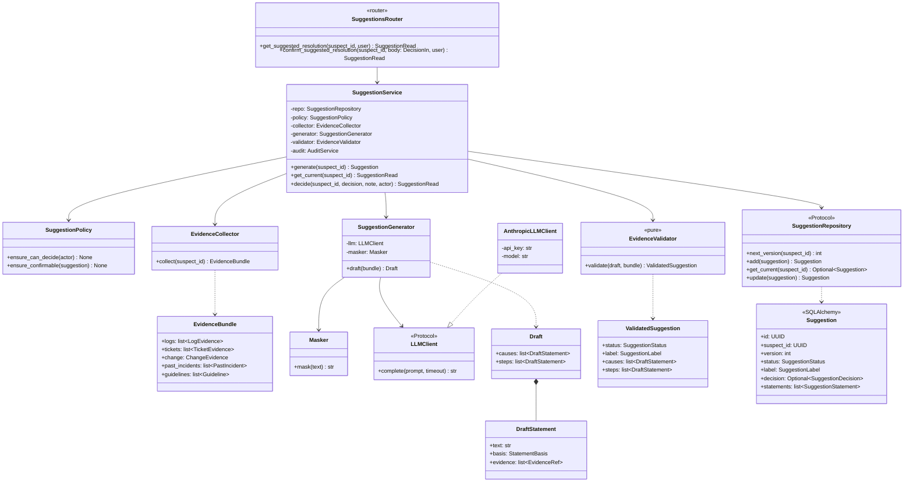

Authentication, enums, validator rules, and mapping boundaries: [Class diagrams](docs/architecture/uml/01-class-diagrams.md).

### 6.3 Sequence diagrams

Seven runtime sequences map each user story and OpenAPI operation to its router, service, policy/validator, repository, database interaction, and error paths:

| # | Flow | Trigger |
|---|---|---|
| 1 | Login | `POST /auth/login` |
| 2 | Create and edit a change (own-record rule) | `POST /changes`, `PUT /changes/{changeId}` |
| 3 | Ingest error logs (masking, idempotency) | `POST /integration/logs` |
| 4 | Detect anomaly and rank suspects | Scheduled worker job |
| 5 | Generate suggested resolution (LLM, validation) | `SUGGESTION_GENERATION` job |
| 6 | Review anomaly, suspects, and suggestion | `GET /anomalies/{id}/suspects`, `GET /suspects/{id}/suggestion` |
| 7 | Confirm or reject a suggestion | `PUT /suspects/{id}/suggestion/confirmation` |

- [Sequence diagrams](docs/architecture/uml/02-sequence-diagrams.md)
- [Detailed UML overview](docs/architecture/uml/README.md)

### 6.4 Algorithms — baseline, anomaly detection, suspect ranking

The three algorithms are rule-based and explainable; no LLM is involved until they finish.

| Algorithm | Rule |
|---|---|
| Baseline | Mean and std dev of weekly ticket counts per category × weekday × hour (optionally per department or branch), last 8 weeks, empty hours = 0, resolved incidents excluded, ≥ 3 weeks required |
| Detection | Every 15 min over the last 60 min: `z = (actual − expected) / max(std, √max(expected,1))`; abnormal if z > 3; HIGH ≥ 6, MEDIUM ≥ 4.5 |
| Ranking | Changes started ≤ 48 h before the spike; five factors in [0,1] (time, scope, keyword, magnitude, risk); weighted score 0–100; capped at 39 when neither scope nor keyword matches |

Printer case, computed by the prototype: baseline 1.5 ± 0.76, 14 tickets → z = 10.2 (HIGH); Windows patch **80 (High, #1)**, unrelated ERP upgrade 39 and mail config 35 (Low).

Formulas, SQL, edge cases, and tuning: [Algorithms](docs/09-algorithms.md).

## Documentation

- Requirements: [Scope](docs/01-scope.md), [Features](docs/02-features.md), [INVEST backlog](docs/05-invest-requirements.md), [Acceptance criteria](docs/08-acceptance-criteria.md).
- Requirements catalogs: [Business rules](docs/requirements/business-rules.md) and [Non-functional requirements](docs/requirements/non-functional-requirements.md).
- Actors and use cases: [Actors, roles, and use cases](docs/03-use-cases.md).
- UI/UX: [Information architecture](docs/04-information-architecture.md).
- Architecture: [C4 model](docs/architecture/c4/README.md), [AI pipeline and knowledge graph](docs/architecture/ai-pipeline.md).
- Folder structure: [Next.js and FastAPI modules](docs/07-folder-structure.md).
- Algorithms: [Baseline, anomaly detection, suspect ranking](docs/09-algorithms.md).
- Code-level design: [C4 Level 4](docs/architecture/c4/04-code.md), [class diagrams](docs/architecture/uml/01-class-diagrams.md), [sequence diagrams](docs/architecture/uml/02-sequence-diagrams.md).
- Database: [Data model](docs/06-data-model.md), [ER diagram](docs/DATABASE.md), [PostgreSQL schema](src/database/cic.sql).
- API contract: [OpenAPI 3.0 specification](docs/api/openapi.yaml) and [API documentation](docs/api/README.md).
- Agent rules: [CLAUDE.md](CLAUDE.md).

## Project Progress

- [x] Define scope, goals, and user roles
- [x] Write the feature list and use cases
- [x] Write user stories following INVEST
- [x] Design the information architecture and screen permissions
- [x] Design the screen hierarchy, task flows, and UI states
- [x] Write acceptance criteria and business rules
- [x] Write non-functional requirements
- [x] Design the baseline, anomaly detection, and suspect ranking algorithms
- [x] Design the C4 System Context, Container, and Component views
- [x] Design the database schema and data relationships
- [x] Write the API documentation in OpenAPI 3.0
- [x] Design the Next.js frontend and FastAPI backend folder structure
- [x] Design class diagrams and sequence diagrams
- [ ] Build the UI prototype for each role
- [ ] Build the backend and connect the frontend to the API
