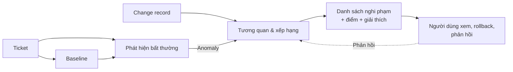
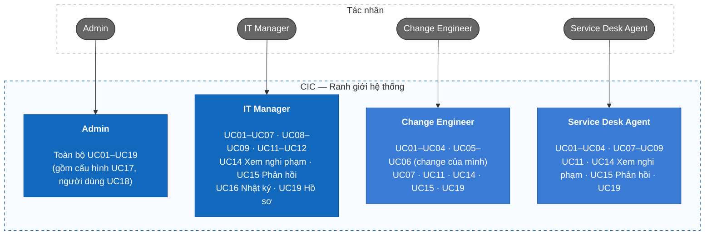
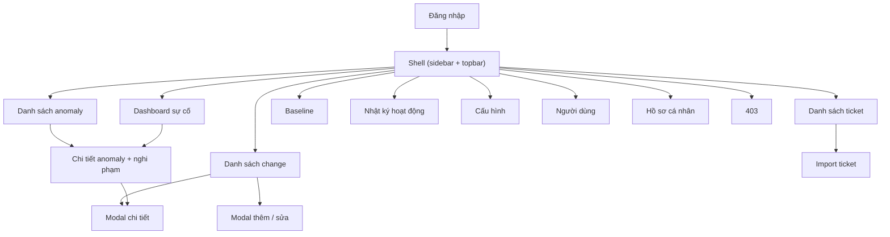

# Change-Incident Correlation (CIC)

Hệ thống truy vết sự cố do thay đổi: khi số ticket tăng bất thường, hệ thống tự trả lời **"thay đổi nào gần đây có khả năng là nguyên nhân?"** và xếp hạng các "nghi phạm".

> **Ví dụ:** 22h thứ Ba, IT cập nhật bản vá Windows cho phòng Kế toán. Sáng thứ Tư có 14 ticket "không in được". CIC phát hiện đợt tăng bất thường, nối với bản vá đó, và đưa nó lên đầu danh sách nghi phạm cùng kế hoạch rollback và người thực hiện.

> **Trạng thái:** giai đoạn tài liệu — hiện có Scope, Features, Use cases và Information Architecture. Các phần kiến trúc kỹ thuật, dữ liệu, API sẽ bổ sung sau.

## 1. Yêu cầu — Dữ liệu đầu vào, User story, Use case

### 1.1 Dữ liệu đầu vào

| Nguồn | Nội dung chính |
|---|---|
| **Change record** | Loại (bản vá, đổi cấu hình, nâng cấp phần mềm), thời điểm, phạm vi ảnh hưởng (nhóm máy, phòng ban, phần mềm, chi nhánh), người thực hiện, kế hoạch rollback |
| **Ticket** | Thời điểm, danh mục, người báo (phòng ban, chi nhánh), thiết bị/phần mềm liên quan, mô tả |
| **Baseline** | Số ticket trung bình theo khung giờ / thứ / danh mục |

Chi tiết trường dữ liệu: [Phạm vi V1](docs/01-scope.md).

### 1.2 Luồng xử lý tổng quát



### 1.3 User story

Backlog V1 gồm 19 user story, đánh giá theo INVEST:

```text
US01–US02   Xác thực
US03        Dashboard sự cố
US04–US06   Quản lý change
US07–US09   Quản lý ticket và import
US10–US11   Baseline
US12–US14   Anomaly, nghi phạm, phản hồi
US15        Nhật ký hoạt động
US16        Cấu hình
US17–US18   Người dùng và hồ sơ
US19        Tích hợp API từ ITSM
```

Danh sách đầy đủ: [Tác nhân, vai trò và use case](docs/03-use-cases.md#5-user-story-v1-đánh-giá-theo-invest).

### 1.4 Use case



Hai tác nhân hệ thống — **ITSM** (UC10, đẩy ticket/change qua API) và **Bộ xử lý nền** (UC13, phát hiện bất thường) — không hiển thị ở sơ đồ trên. Chi tiết: [Tác nhân, vai trò và use case](docs/03-use-cases.md).

### 1.5 Vai trò và quyền hạn

| Chức năng | Admin | IT Manager | Change Engineer | Agent |
|---|---|---|---|---|
| Xem dashboard, anomaly, nghi phạm | Có | Có | Có | Có |
| Xem change và ticket | Có | Có | Có | Có |
| Tạo change | Có | Có | Có | Không |
| Sửa change | Có | Có | Chỉ change của mình | Không |
| Tạo / import ticket | Có | Có | Không | Có |
| Xem / tính lại baseline | Có | Có | Chỉ xem | Chỉ xem |
| Phản hồi nghi phạm | Có | Có | Có | Có |
| Nhật ký hoạt động | Có | Có | Không | Không |
| Cấu hình hệ thống | Có | Không | Không | Không |
| Quản lý người dùng | Có | Không | Không | Không |

Backend phải thực thi RBAC và chính sách "chỉ change của mình"; việc ẩn nút ở frontend chỉ phục vụ UI/UX.

## 2. Kiến trúc thông tin (Information Architecture)

Không gian làm việc sau đăng nhập được tổ chức theo năng lực nghiệp vụ. Điều hướng tuân theo ma trận vai trò; mục không đủ quyền không hiển thị.

### 2.1 Cây thông tin

```text
Công khai
└── Đăng nhập

Sau đăng nhập
├── Dashboard sự cố
├── Anomaly (danh sách, chi tiết + nghi phạm xếp hạng)
├── Change
├── Ticket (gồm Import)
├── Baseline
├── Nhật ký hoạt động
├── Cấu hình
├── Người dùng
├── Hồ sơ cá nhân
└── 403 Không đủ quyền
```

### 2.2 Phân cấp màn hình



Shell sở hữu điều hướng tới các trang tính năng; thao tác tạo/sửa change, ticket, người dùng dùng modal thuộc tính năng đó. Điều hướng trái quyền dẫn tới màn hình 403.

Mã màn hình, luồng tác vụ, trạng thái UI, quy tắc truy cập và ánh xạ use case — màn hình: [Kiến trúc thông tin](docs/04-information-architecture.md).

## Tài liệu

| Tài liệu | Nội dung |
|---|---|
| [docs/01-scope.md](docs/01-scope.md) | Bài toán, mục tiêu, dữ liệu đầu vào, ngoài phạm vi |
| [docs/02-features.md](docs/02-features.md) | Danh mục tính năng F01–F11 |
| [docs/03-use-cases.md](docs/03-use-cases.md) | Tác nhân, use case, phân quyền, user story |
| [docs/04-information-architecture.md](docs/04-information-architecture.md) | Cây thông tin, màn hình, trạng thái UI |
| [docs/CIC-Tai-lieu-thiet-ke.docx](docs/CIC-Tai-lieu-thiet-ke.docx) | Bản Word gộp các tài liệu trên |

## Tiến độ

- [x] Phạm vi, tính năng, use case, user story
- [x] Kiến trúc thông tin
- [ ] Mô hình dữ liệu và ERD
- [ ] Thiết kế thuật toán baseline, phát hiện bất thường, xếp hạng
- [ ] Kiến trúc C4, API (OpenAPI)
- [ ] Triển khai
