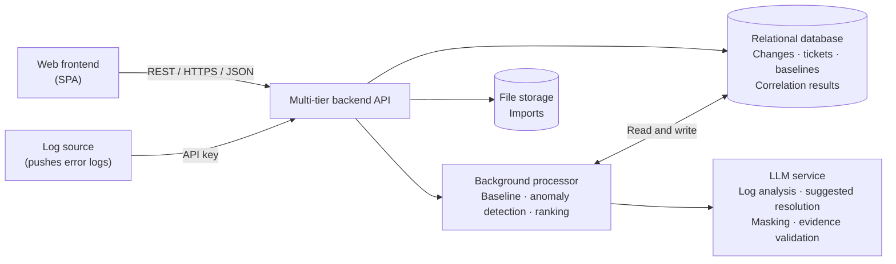

# Scope V1

> Design status: TARGET V1
>
> Implementation status: NOT STARTED (documentation phase)

Product name: **Change-Incident Correlation (CIC)**.

## Problem

When tickets rise abnormally, the IT team needs to answer quickly: **which recent change is the likely cause?**

Real example: on Tuesday at 22:00 IT applies a Windows patch to the Accounting department. On Wednesday morning there are 14 "cannot print" tickets. Today only an experienced person can connect the two events; service desk agents usually handle each ticket on its own and may need hours to realize it is one shared incident.

A good solution needs a simple place to:

- record changes with their scope and rollback plan;
- receive tickets from several sources;
- know the normal ticket volume (baseline);
- detect when volume is abnormal;
- rank recent changes as suspects, with reasons the user can verify.

This is not an ITSM replacement, not a CMDB, and not a root-cause analysis tool.

## Input data

### Change record

| Field | Description |
|---|---|
| Type | Patch · configuration change · software upgrade |
| Time | Start and end of execution (with time zone) |
| Scope | Device group, department, software, branch (one or more) |
| Implementer | IT account that performed the change, and the approver |
| Rollback plan | Available or not, steps, estimated duration, risk level |
| Status | Scheduled · In progress · Completed · Rolled back · Failed |

### Ticket

| Field | Description |
|---|---|
| Created time | When the user reported the problem |
| Category | For example: Printing, Network, Email, Accounting software, Login |
| Reporter | Department and branch of the reporter |
| Related device / software | Device group, software name, version |
| Description | Free text, used for keyword matching against changes |
| Status | New · In progress · Resolved · Closed |

### Error log

| Field | Description |
|---|---|
| Occurred time | When the error happened (with time zone) |
| Source | Service or software, device group |
| Scope | Department and branch (mapped from the device or service) |
| Level | Warning · Error · Critical |
| Error code / message | Text of the error, masked before analysis |
| Signature | Normalized form used to group identical errors |

Sensitive data in logs (user names, e-mail addresses, IP addresses, file paths) is masked before a log is stored for analysis or sent to the LLM.

### Baseline

Average ticket count (and standard deviation) per **hour slot × weekday × category**, computed from ticket history (default: last 8 weeks, excluding periods already marked as incidents).

## Target V1 goals

The target V1 supports:

- Login through the REST API with backend authentication and authorization.
- Change management (list, add/edit modal, detail modal, status updates).
- Ticket management with manual entry, CSV/Excel import (preview and validation), and API ingestion from an ITSM system.
- Baseline calculation and comparison with actual volume.
- Anomaly detection per category, department, branch, and software.
- Ranked suspect changes with an explainable score (0–100).
- Error log intake: receive error logs through the API, normalize them, mask sensitive data, classify the error, and link logs to anomalies and suspects by time and scope.
- AI analysis and suggested resolution for each suspect change. The cause must cite evidence (related logs, tickets, change, rollback plan). The resolution has two kinds: **standard** (rollback plan, previously confirmed incidents, internal guidance) and **flexible** (the LLM's general knowledge). Flexible resolutions are always labeled *hypothesis*.
- Suspect feedback (correct cause / unrelated) to measure and tune accuracy.
- Persisted audit log.
- System configuration (thresholds, tracing window, ranking weights, log retention).
- User management (Admin) and personal profile.
- Backend-enforced roles and permissions.

## Non-goals

V1 does **not** include:

- Automatic execution of rollback or any change on real infrastructure.
- Replacing the ITSM or CMDB; CIC reads and correlates data only.
- Collecting logs from servers or devices (no agent or collector); CIC only receives logs pushed through the API.
- A log-management platform: logs are kept for a configurable retention period and are not searchable as a general log store.
- Predicting incidents before a change is applied.
- Free-form chatbot or conversational assistant. The LLM only explains suspects and drafts suggested resolutions; it never computes the suspicion score.
- Presenting an LLM-knowledge resolution as verified. It is always a hypothesis until a person with permission confirms it. The system suggests only; it never executes a resolution.
- External identity providers and multi-factor authentication.

## Target V1 architecture

This is an idea-level view. Detailed architecture (C4, data model, API) is defined in later phases.
