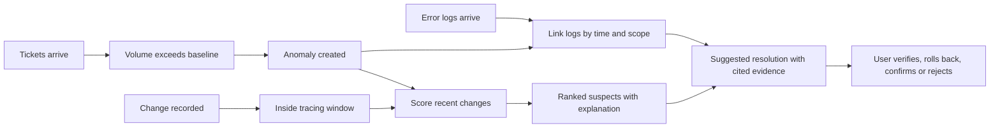

# Actors, roles, use cases

> Design status: TARGET V1
>
> Current implementation: none (documentation phase)

Product name: **CIC**.

## Actors / roles

| Role | Display name in UI | Description |
|---|---|---|
| `ADMIN` | Administrator | Manages users and system configuration; full access. |
| `IT_MANAGER` | IT Manager | Monitors incidents, reviews suspects, decides on rollback, reads the audit log. |
| `CHANGE_ENGINEER` | Change Engineer | Performs changes; maintains change records and rollback plans. |
| `AGENT` | Service Desk Agent | Handles tickets, watches anomalies, uses suspects to route tickets. |

System actors:

| Actor | Description |
|---|---|
| ITSM system | Pushes tickets and changes through the API. |
| Log source | Pushes error logs through the API. |
| Background processor | Computes baselines, detects anomalies, ranks suspects, analyzes related logs, drafts suggested resolutions. |

## Role × feature matrix

| Feature | Admin | IT Manager | Change Engineer | Agent |
|---|---|---|---|---|
| Dashboard | ✓ | ✓ | ✓ | ✓ |
| View anomalies and suspects | ✓ | ✓ | ✓ | ✓ |
| Give suspect feedback | ✓ | ✓ | ✓ | ✓ |
| View related error logs | ✓ | ✓ | ✓ | ✓ |
| View suggested resolution | ✓ | ✓ | ✓ | ✓ |
| Confirm / reject suggested resolution | ✓ | ✓ | ✓ | |
| View changes | ✓ | ✓ | ✓ | ✓ |
| Add change | ✓ | ✓ | ✓ | |
| Edit change | ✓ | ✓ | Own records | |
| View tickets | ✓ | ✓ | ✓ | ✓ |
| Add / import tickets | ✓ | ✓ | | ✓ |
| View baseline | ✓ | ✓ | ✓ | ✓ |
| Recompute baseline | ✓ | ✓ | | |
| Audit log | ✓ | ✓ | | |
| System configuration | ✓ | | | |
| Users | ✓ | | | |
| Personal profile | ✓ | ✓ | ✓ | ✓ |

Menus / buttons are **not displayed** when the user lacks permission. Unauthorized access resolves to the 403 screen. The backend enforces the same rules.

## Use case list

| ID | Use case | Primary actor |
|---|---|---|
| UC01 | Login | All users |
| UC02 | Logout | All users |
| UC03 | View incident dashboard | All users |
| UC04 | View change list and detail | All users |
| UC05 | Create change record | Change Engineer, IT Manager, Admin |
| UC06 | Edit change record / update status | Change Engineer (own), IT Manager, Admin |
| UC07 | View ticket list and detail | All users |
| UC08 | Add ticket manually | Agent, IT Manager, Admin |
| UC09 | Import tickets from CSV/Excel | Agent, IT Manager, Admin |
| UC10 | Receive tickets/changes through the API | ITSM system |
| UC11 | View baseline | All users |
| UC12 | Recompute baseline | IT Manager, Admin |
| UC13 | Detect anomalies, rank suspects, analyze related logs | Background processor |
| UC14 | View anomaly detail and ranked suspects | All users |
| UC15 | Give suspect feedback (correct cause / unrelated) | All users |
| UC22 | Receive error logs through the API | Log source |
| UC23 | View error logs related to an anomaly | All users |
| UC20 | View suggested resolution of a suspect | All users |
| UC21 | Confirm / reject suggested resolution | IT Manager, Change Engineer, Admin |
| UC16 | View audit log | IT Manager, Admin |
| UC17 | Configure thresholds, tracing window, weights | Admin |
| UC18 | Manage users | Admin |
| UC19 | Manage personal profile / change password | All users |

## Use Case Diagram

The use case diagram is maintained in the [project README](../README.md#13-use-cases).

## Main use case: UC14 View anomaly detail and ranked suspects

| Item | Content |
|---|---|
| Precondition | The user is logged in and at least one anomaly exists. |
| Main flow | 1. The user opens the dashboard and selects an anomaly. 2. The system shows the affected group, time range, and actual versus baseline tickets. 3. The system lists suspect changes by descending score, each with a per-factor explanation. 4. The user opens a suspect to see related tickets, implementer, rollback plan, and the related error logs (UC23), and the suggested resolution (UC20). |
| Alternative flow | No change inside the tracing window → show "No suspect found" and suggest widening the window. |
| Postcondition | No data is changed. |

## Use case: UC22 / UC23 Error logs

| Item | Content |
|---|---|
| Precondition | UC22: the log source holds a valid API key. UC23: the user is logged in and an anomaly exists. |
| UC22 flow | 1. The log source pushes a batch of error logs. 2. The system validates it, masks sensitive data, normalizes and classifies each log, and stores it. 3. Logs already received (same `externalId`) are not stored twice. |
| UC23 flow | 1. The user opens an anomaly. 2. The system lists the error logs linked to it (inside the tracing window and matching its scope), grouped by signature with counts. |
| Alternative flow | No related logs → show "No related logs"; the analysis then relies on tickets and the change only. |

## Use case: UC20 / UC21 Suggested resolution

| Item | Content |
|---|---|
| Precondition | A suspect exists for an anomaly. |
| UC20 flow | 1. The user opens a suspect. 2. The system shows the likely cause, each statement citing its evidence (logs, tickets, change). 3. The system shows the resolution in two kinds: **Standard** (cites its source) and **Flexible** (LLM knowledge, always labeled **Hypothesis**). |
| UC21 flow | 1. An IT Manager, Change Engineer, or Administrator marks the suggestion as confirmed or rejected, with a note. 2. The system stores the outcome; a confirmed suggestion becomes reusable evidence for later similar incidents. |
| Alternative flow | No evidence supports the cause → show "No supported suggestion". Agents can view but cannot confirm. |
| Rule | The system only suggests; it never executes a rollback or fix. A flexible resolution is never shown as confirmed unless a person confirms it. |

## Business flow: from change to suspect

