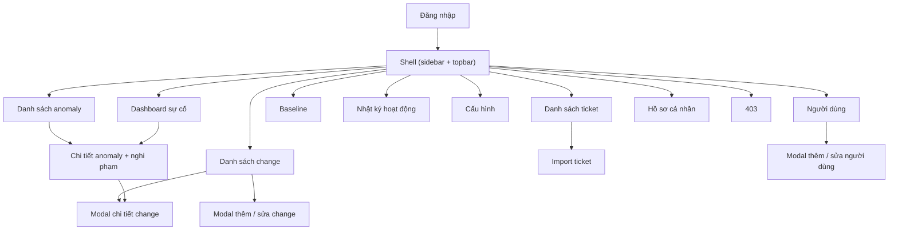
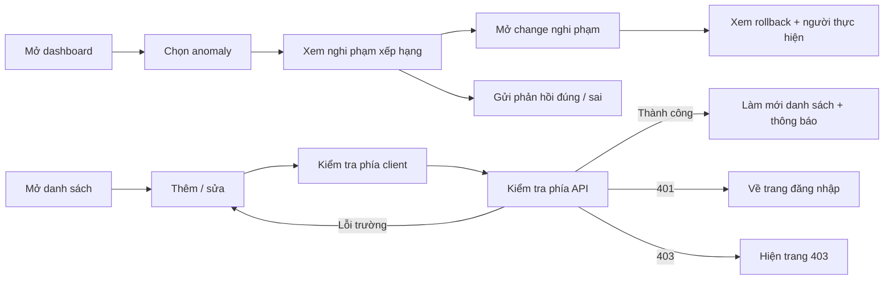

# 04. Kiến trúc thông tin (Information Architecture)

> Trạng thái thiết kế: TARGET V1

Kiến trúc thông tin tổ chức không gian làm việc sau đăng nhập theo **năng lực nghiệp vụ**. Điều hướng và quyền truy cập từng trang tuân theo ma trận vai trò; mục không đủ quyền **không hiển thị** trên thanh điều hướng.

## 1. Cây thông tin

```text
Change-Incident Correlation
│
├── Công khai
│   └── Đăng nhập
│
└── Sau đăng nhập (sidebar + topbar)
    ├── Dashboard sự cố
    │   ├── Anomaly đang mở
    │   ├── Biểu đồ ticket so với baseline
    │   └── Top nghi phạm
    ├── Anomaly
    │   ├── Danh sách (lọc theo nhóm, thời gian, mức nghiêm trọng)
    │   └── Chi tiết anomaly
    │       ├── Nghi phạm xếp hạng (+ giải thích điểm)
    │       ├── Ticket liên quan
    │       ├── Dòng thời gian (change + ticket)
    │       └── Phản hồi nghi phạm
    ├── Change
    │   ├── Danh sách (bảng, bộ lọc, phân trang)
    │   ├── Modal thêm / sửa
    │   └── Chi tiết (phạm vi, người thực hiện, kế hoạch rollback)
    ├── Ticket
    │   ├── Danh sách
    │   ├── Modal thêm
    │   └── Import (xem trước, lịch sử import)
    ├── Baseline
    │   ├── Biểu đồ theo khung giờ / thứ / danh mục
    │   └── Tính lại baseline
    ├── Nhật ký hoạt động
    ├── Cấu hình
    │   ├── Ngưỡng & cửa sổ truy vết
    │   ├── Trọng số xếp hạng
    │   └── Danh mục & ánh xạ phạm vi
    ├── Người dùng
    ├── Hồ sơ cá nhân
    │   ├── Tài khoản
    │   ├── Bảo mật
    │   └── Vai trò & quyền
    └── 403 Không đủ quyền
```

## 2. Phân quyền theo trang

| Trang | Ai được truy cập |
|---|---|
| Dashboard, Anomaly, Hồ sơ cá nhân | Mọi vai trò |
| Change (xem) / Ticket (xem) | Mọi vai trò |
| Thêm / sửa Change | Admin, IT Manager, Change Engineer (sửa change của mình) |
| Thêm / Import Ticket | Admin, IT Manager, Agent |
| Baseline | Mọi vai trò xem; Admin, IT Manager tính lại |
| Nhật ký hoạt động | Admin, IT Manager |
| Cấu hình | Admin |
| Người dùng | Admin |
| Không đủ quyền | `/403` |

## 3. Danh mục màn hình

| Mã | Màn hình | Hình thức | Use case |
|---|---|---|---|
| SCR-01 | Đăng nhập | Trang | UC01, UC02 |
| SCR-02 | Dashboard sự cố | Trang | UC03 |
| SCR-10 | Danh sách anomaly | Trang | UC14 |
| SCR-11 | Chi tiết anomaly và nghi phạm | Trang | UC14, UC15 |
| SCR-20 | Danh sách change | Trang | UC04 |
| SCR-21 | Thêm / sửa change | Modal trên danh sách change | UC05, UC06 |
| SCR-22 | Chi tiết change | Modal trên danh sách change | UC04 |
| SCR-30 | Danh sách ticket | Trang | UC07, UC08 |
| SCR-31 | Import ticket (xem trước / lịch sử) | Trang | UC09 |
| SCR-40 | Baseline | Trang | UC11, UC12 |
| SCR-50 | Nhật ký hoạt động | Trang | UC16 |
| SCR-60 | Cấu hình hệ thống | Trang có tab | UC17 |
| SCR-70 | Quản lý người dùng | Trang + modal | UC18 |
| SCR-80 | Hồ sơ cá nhân | Trang có tab | UC19 |
| SCR-90 | Không đủ quyền (403) | Trang | Phân quyền chung |

## 4. Ánh xạ use case — màn hình

| Use case | Màn hình / hành động chính |
|---|---|
| UC01, UC02 | SCR-01 đăng nhập; đăng xuất tại shell, quay về SCR-01 |
| UC03 | SCR-02 đổi khoảng thời gian, lọc nhóm |
| UC04 | SCR-20 lọc/xem danh sách, SCR-22 xem chi tiết |
| UC05, UC06 | SCR-21 gửi biểu mẫu tạo/sửa change |
| UC07, UC08 | SCR-30 lọc danh sách, thêm ticket |
| UC09 | SCR-31 xem trước, xác nhận import, xem lịch sử |
| UC10, UC13 | Không có màn hình riêng (API / tiến trình nền); kết quả hiện ở SCR-02, SCR-10 |
| UC11, UC12 | SCR-40 xem biểu đồ, tính lại |
| UC14, UC15 | SCR-11 xem nghi phạm, gửi phản hồi |
| UC16 | SCR-50 |
| UC17 | SCR-60 |
| UC18 | SCR-70 |
| UC19 | SCR-80 |

## 5. Phân cấp màn hình



## 6. Luồng tác vụ chính



## 7. Hợp đồng trạng thái UI/UX

| Trạng thái | Hành vi bắt buộc |
|---|---|
| Đang tải lần đầu | Giữ khung trang, hiển thị skeleton cho vùng bị ảnh hưởng. |
| Rỗng | Giải thích không có bản ghi; phân biệt "chưa có dữ liệu" với "bị lọc hết"; hiện hành động chính nếu được phép. |
| Lỗi hợp lệ dữ liệu | Giữ giá trị đã nhập, gắn thông báo vào đúng trường, focus vào lỗi đầu tiên. |
| Lỗi API | Hiện thông báo ngắn gọn kèm mã tham chiếu; không lộ chi tiết kỹ thuật. |
| Chưa xác thực (401) | Xóa phiên không hợp lệ và về trang đăng nhập. |
| Không đủ quyền (403) | Giữ phiên, hiện trang 403 có đường quay lại an toàn. |
| Đang lưu / import | Khóa gửi trùng, hiện tiến trình. |
| Thành công | Xác nhận, đóng modal khi phù hợp, làm mới dữ liệu liên quan. |
| Anomaly chưa có nghi phạm | Hiện "Không tìm thấy nghi phạm" kèm gợi ý mở rộng cửa sổ truy vết. |

## 8. Quy tắc responsive và truy cập

- Bảng trên desktop giữ đầy đủ cột; màn hình hẹp cuộn ngang hoặc dùng thẻ tóm tắt, không ẩn dữ liệu vĩnh viễn.
- Modal vừa khung nhìn, giữ nút hành động hiển thị, bẫy focus bàn phím, đóng bằng `Escape` khi không đang gửi, trả focus về nút mở.
- Mọi ô nhập có nhãn; nút chỉ có biểu tượng có tên truy cập; trạng thái không chỉ truyền đạt bằng màu (điểm khả nghi luôn kèm số và nhãn).
- Thời gian hiển thị kèm múi giờ; điểm khả nghi hiển thị dạng số 0–100 cùng mức (Cao / Trung bình / Thấp).
