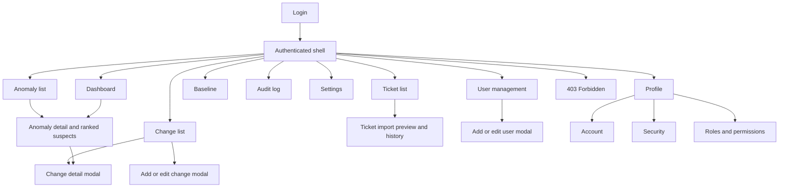
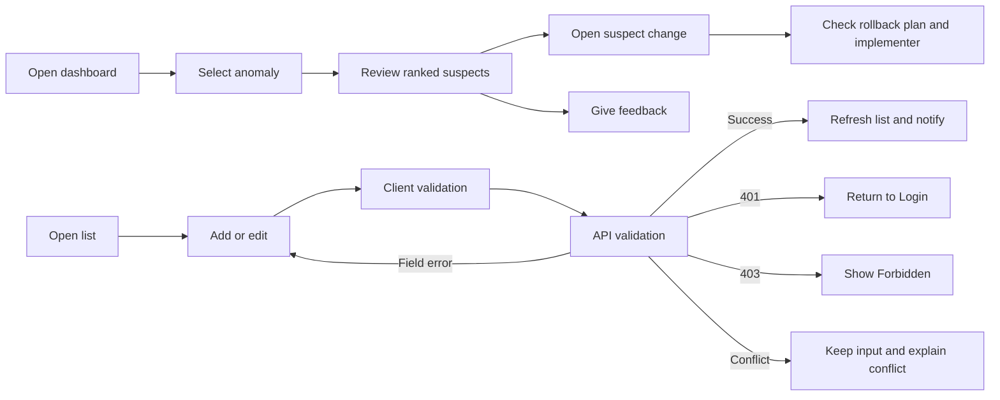

# Information architecture

> Design status: TARGET V1
>
> Current implementation: none (documentation phase)

**Organization scheme.** Pages are grouped by the *job the user is doing*, not by database table: **Monitor** (what is wrong now), **Records** (the data that explains it), **Analysis** (what normal looks like), and **Administration** (who and how the system is configured). Inside a group, items are organized by object (Change, Ticket, Anomaly).

**Site map.** Level 0 is the product, level 1 is a navigation group, level 2 is a page, level 3 is a section or modal inside a page.

```mermaid
flowchart TB
    CIC(["CIC"])
    CIC --> Public["Public"]
    CIC --> Shell["Authenticated workspace<br/>(sidebar + topbar)"]
    CIC --> Sys["System page"]
    Public --> Login["Login"]
    Sys --> Forbidden["403 Forbidden"]

    Shell --> Monitor["MONITOR"]
    Shell --> Records["RECORDS"]
    Shell --> Analysis["ANALYSIS"]
    Shell --> Admin["ADMINISTRATION"]
    Shell --> Utility["UTILITY (topbar)"]

    Monitor --> Dash["Dashboard"]
    Dash --> D1["Open anomalies"]
    Dash --> D2["Tickets versus baseline"]
    Dash --> D3["Top suspects"]
    Monitor --> Anom["Anomalies"]
    Anom --> A1["Anomaly list"]
    Anom --> A2["Anomaly detail"]
    A2 --> A3["Ranked suspects<br/>score + explanation"]
    A2 --> A4["Related tickets"]
    A2 --> A5["Timeline"]
    A2 --> A6["Suspect feedback"]
    A2 --> A7["Suggested resolution<br/>evidence + confirm"]

    Records --> Chg["Changes"]
    Chg --> C1["Change list"]
    Chg --> C2["Add / edit change<br/>(modal)"]
    Chg --> C3["Change detail<br/>(modal)"]
    Records --> Tkt["Tickets"]
    Tkt --> T1["Ticket list"]
    Tkt --> T2["Add ticket<br/>(modal)"]
    Tkt --> T3["Import<br/>preview + history"]

    Analysis --> Base["Baseline"]
    Base --> B1["Baseline versus actual"]
    Base --> B2["Recompute"]

    Admin --> Audit["Audit log"]
    Admin --> Set["Settings"]
    Set --> S1["Thresholds and tracing window"]
    Set --> S2["Ranking weights"]
    Set --> S3["Categories and scope mappings"]
    Admin --> Usr["Users"]
    Usr --> U1["Add / edit user<br/>(modal)"]

    Utility --> Prof["Profile"]
    Prof --> P1["Account"]
    Prof --> P2["Security"]
    Prof --> P3["Roles and permissions"]
    Utility --> U2["Time range and time zone"]
    Utility --> U3["Log out"]

    classDef root fill:#222,color:#fff,stroke:#000
    classDef group fill:#1168bd,color:#fff,stroke:#0b4f9e
    classDef page fill:#dbeafe,color:#111,stroke:#3a7bd5
    classDef leaf fill:#fff,color:#111,stroke:#bbb
    class CIC root
    class Monitor,Records,Analysis,Admin,Utility group
    class Dash,Anom,Chg,Tkt,Base,Audit,Set,Usr,Prof page
    class D1,D2,D3,A1,A2,A3,A4,A5,A6,A7,C1,C2,C3,T1,T2,T3,B1,B2,S1,S2,S3,U1,U2,U3,P1,P2,P3,Login,Forbidden leaf
```

**Navigation model.**

| Layer | Where | Content |
|---|---|---|
| Global | Sidebar | The four groups and their level-2 pages; groups with no permitted page are hidden |
| Utility | Topbar | Profile, time range / time zone, logout |
| Local | Tabs inside a page | Anomaly detail (Suspects · Related tickets · Timeline), Settings, Profile |
| Contextual | Links inside content | Suspect → change detail; change detail → anomalies it is suspected in; ticket → anomaly it belongs to |

**Labeling.** Labels use the user's vocabulary and one term per concept: *Change* (never "modification"), *Ticket*, *Anomaly*, *Suspect*, *Baseline*. A suspect always shows its score as a number plus a High / Medium / Low label.

**Role scope.** Every level-2 page declares which roles can see it (see Page permissions below). Unauthorized pages are not rendered in the sidebar, and direct access resolves to 403.

Routes: `/login` `/dashboard` `/anomalies` `/anomalies/:id` `/changes` `/tickets` `/tickets/import` `/baseline` `/audit` `/settings` `/users` `/profile` `/403`.

Change, ticket, and user forms open as a **modal** on the list page. Route-level modal URLs are a target design decision to be confirmed during UI implementation.

**Time display:** every timestamp shows its time zone. Anomaly and suspect times are shown in the viewer's time zone.

## Page permissions

| Page | Who can access |
|---|---|
| Dashboard, anomalies, profile | all roles |
| Changes / tickets (view) | all roles |
| Add/edit changes | ADMIN, IT_MANAGER, CHANGE_ENGINEER (own records only) |
| Add / import tickets | ADMIN, IT_MANAGER, AGENT |
| Baseline | all roles view; ADMIN, IT_MANAGER recompute |
| Activity Log | ADMIN, IT_MANAGER |
| Settings | ADMIN only |
| Users | ADMIN only |
| Unauthorized | `/403` |

Unauthorized items are **not rendered** in the sidebar.

## Screen inventory

| Screen ID | Screen | Presentation | Related use cases |
|---|---|---|---|
| `SCR-01` | Login | Page | UC01, UC02 |
| `SCR-02` | Dashboard | Page | UC03 |
| `SCR-10` | Anomaly list | Page | UC14 |
| `SCR-11` | Anomaly detail, suspects, and suggested resolution | Page | UC14, UC15, UC20, UC21 |
| `SCR-20` | Change list | Page | UC04 |
| `SCR-21` | Change create / edit | Modal on change list | UC05, UC06 |
| `SCR-22` | Change detail | Modal on change list | UC04 |
| `SCR-30` | Ticket list | Page | UC07, UC08 |
| `SCR-31` | Ticket import preview/history | Page | UC09 |
| `SCR-40` | Baseline | Page | UC11, UC12 |
| `SCR-50` | Audit log | Page | UC16 |
| `SCR-60` | Settings | Tabbed page | UC17 |
| `SCR-70` | User management | Page with form modal | UC18 |
| `SCR-80` | Personal profile | Tabbed page | UC19 |
| `SCR-90` | Forbidden | Page | Cross-cutting authorization |

## Requirement-to-screen mapping

| Requirement | Primary screen/action |
|---|---|
| US01 | `SCR-01` submit login |
| US02 | Authenticated shell logout action, returning to `SCR-01` |
| US03 | `SCR-02` change date range / filter group |
| US04 | `SCR-21` submit change creation |
| US05 | `SCR-21` submit change update / status change |
| US06 | `SCR-20` filter/list and `SCR-22` inspect change |
| US07 | `SCR-30` submit ticket creation |
| US08 | `SCR-31` preview, submit, and inspect import status/history |
| US09 | `SCR-30` filter/list and inspect ticket |
| US10 | `SCR-40` inspect baseline versus actual |
| US11 | `SCR-40` recompute baseline |
| US12 | `SCR-10` list and `SCR-11` inspect ranked suspects |
| US13 | `SCR-11` open suspect to see rollback plan and implementer |
| US14 | `SCR-11` submit suspect feedback |
| US20 | `SCR-11` open a suspect to read the suggested resolution and its evidence |
| US21 | `SCR-11` confirm or reject the suggested resolution |
| US15 | `SCR-50` filter and inspect audit events |
| US16 | `SCR-60` edit thresholds, window, weights |
| US17 | `SCR-70` list/create/edit/enable/disable users |
| US18 | `SCR-80` update profile or change password |
| US19 | No screen (API); results appear on `SCR-20`, `SCR-30` |

## Screen hierarchy

## Primary task flows

## UI/UX state contract

| State | Required behavior |
|---|---|
| Initial loading | Preserve the page shell; show a skeleton for the affected panel or table. |
| Empty | Explain that no records match; distinguish an empty dataset from filtered-out results; show a permitted primary action. |
| No suspect | Show "No suspect found" and suggest widening the tracing window. |
| No supported suggestion | Show "No supported suggestion" when no evidence backs a resolution; never show uncited text. |
| Suggestion label | Every suggestion shows **Confirmed** or **Hypothesis** and its cited evidence; the confirm action is hidden from roles that cannot confirm. |
| Validation error | Keep entered values, associate text with the invalid field, and focus the first error. |
| API error | Show a concise message with a trace reference; do not expose technical details. |
| Unauthorized | Clear invalid authentication and return to Login. |
| Forbidden | Keep authentication and render `/403` with a safe route back. |
| Saving/importing | Disable duplicate submission and show progress without blocking unrelated navigation unless data loss is possible. |
| Success | Confirm the action, close the modal when appropriate, and refresh the affected query. |

## Responsive and accessibility rules

- Desktop tables retain full-column controls; narrow screens use horizontal scrolling or prioritized summary cards without hiding data permanently.
- Modals fit within the viewport, keep actions visible, trap keyboard focus, close with `Escape` only when no submission is running, and restore focus to the trigger.
- Every input has a visible label; icon-only buttons have accessible names; status is never communicated by color alone (suspect scores always show the number and a High / Medium / Low label).
- Keyboard users can reach navigation, filters, rows, modal actions, and pagination in a predictable order.
- Dates and times have explicit formats and time zones.

## Current UI versus target V1

No UI exists yet; this document is the target design. Field-level coverage of each screen will be reviewed against the data model when it is defined.
