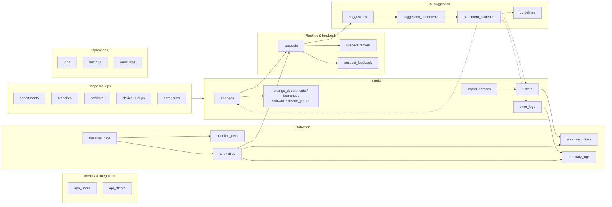
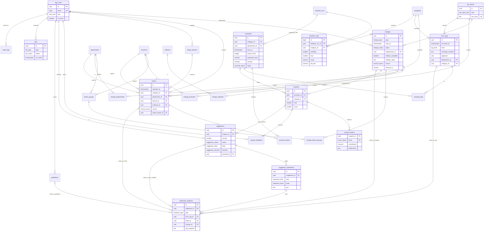

# Database Diagram

> Design status: TARGET V1
>
> Runtime status: SCHEMA DESIGN ONLY; validated on PostgreSQL 16, not connected to an application

PostgreSQL schema `cic` for **Change-Incident Correlation**.

Design files: [cic.sql](../src/database/cic.sql) · [06-data-model.md](06-data-model.md)

## Table groups

## Entity-relationship diagram

`departments`, `branches`, `software`, `device_groups`, `categories`, `import_batches`, `baseline_runs`, `anomaly_tickets`, `anomaly_logs`, `suspect_feedback`, `guidelines`, `settings`, and `audit_logs` appear in the relationships with their attributes omitted for readability; see [cic.sql](../src/database/cic.sql).

## Enums

| Enum | Values |
|---|---|
| `user_role` | ADMIN, IT_MANAGER, CHANGE_ENGINEER, AGENT |
| `api_client_kind` | ITSM, LOG_SOURCE |
| `record_source` | MANUAL, IMPORT, API |
| `change_type` | PATCH, CONFIG_CHANGE, SOFTWARE_UPGRADE |
| `change_status` | SCHEDULED, IN_PROGRESS, COMPLETED, ROLLED_BACK, FAILED |
| `ticket_status` | NEW, IN_PROGRESS, RESOLVED, CLOSED |
| `import_status` | SUCCEEDED, FAILED |
| `log_level` | WARNING, ERROR, CRITICAL |
| `severity` | HIGH, MEDIUM, LOW |
| `anomaly_status` | OPEN, ACKNOWLEDGED, RESOLVED |
| `run_status` | RUNNING, SUCCEEDED, FAILED |
| `score_factor` | TIME_PROXIMITY, SCOPE_MATCH, CATEGORY_KEYWORD_MATCH, ANOMALY_MAGNITUDE, CHANGE_RISK |
| `feedback_verdict` | CORRECT_CAUSE, UNRELATED |
| `suggestion_status` | PENDING, READY, NO_SUPPORT, FAILED |
| `suggestion_label` | CONFIRMED, HYPOTHESIS |
| `suggestion_decision` | CONFIRMED, REJECTED |
| `statement_kind` | CAUSE, STEP |
| `statement_basis` | STANDARD, LLM_KNOWLEDGE |
| `evidence_type` | LOG, TICKET, CHANGE, ROLLBACK_PLAN, PAST_INCIDENT, GUIDELINE |
| `job_type` | BASELINE_RECOMPUTE, ANOMALY_DETECTION, LOG_CLASSIFICATION, SUGGESTION_GENERATION |
| `job_status` | QUEUED, RUNNING, SUCCEEDED, FAILED |
| `audit_action` | LOGIN, LOGOUT, CREATE, UPDATE, STATUS_CHANGE, IMPORT, CONFIG_CHANGE, FEEDBACK, SUGGESTION_DECISION, BASELINE_RECOMPUTE |
