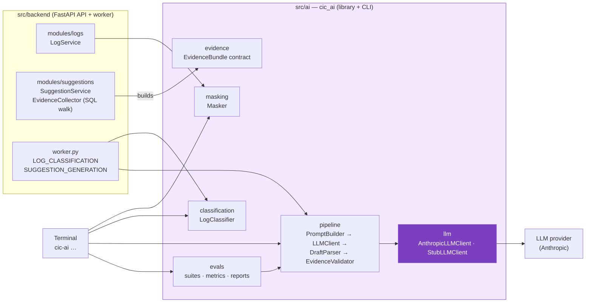

# AI Package `cic_ai` — Boundary, CLI, Evals, and Metrics

> **Status:** Target design · No code yet · Work items: [AI-1](../../project/screens/AI-1.yaml), [AI-2](../../project/screens/AI-2.yaml), [AI-3](../../project/screens/AI-3.yaml), [AI-4](../../project/screens/AI-4.yaml); backend integration in [API-LOGS](../../project/screens/API-LOGS.yaml) and [SCR-11.3](../../project/screens/SCR-11.3.yaml)

The LLM and log-processing parts of CIC live in their own Python package, **`cic_ai`**, in `src/ai/`. The backend and worker import it as a library. It can be developed, tested, and evaluated from the terminal without the database, the API, or the frontend.

Rule-based detection and ranking (baseline, anomaly detection, `SuspectScorer`) are **not** in this package; they stay in `modules/baseline` and `modules/anomalies` so the suspicion score never depends on the LLM (BR-016).

## 1. Boundary



| Stays in the backend | Moves to `cic_ai` |
|---|---|
| HTTP endpoints, auth, RBAC, audit | `Masker` (BR-008) |
| Database access, `EvidenceCollector` (walks the knowledge graph with SQL and returns an `EvidenceBundle`) | `LogClassifier`: normalization, SHA-256 signature, category by keywords |
| `SuggestionService`: versions, status persistence, decisions, labels on confirm (BR-015, BR-017) | `EvidenceBundle` and `Draft` models — the data contract between backend and package |
| Jobs, retries, scheduling (BR-016, NFR-REL-002) | `PromptBuilder`, `SuggestionGenerator`, `DraftParser`, `EvidenceValidator` (BR-013, BR-014) |
| `SuspectScorer`, baseline, anomaly detection | `LLMClient` Protocol, `AnthropicLLMClient`, `StubLLMClient` |
| | Eval suites, metrics, CLI |

Rules:

- `cic_ai` never imports from `src/backend`, never opens a database connection, and has no web server.
- Input and output are plain Pydantic models (`EvidenceBundle` in, `SuggestionRun` out), so the backend and the evals call exactly the same code.
- Only `cic_ai.llm` talks to the LLM provider, and only with text that passed `Masker` (NFR-PRIV-002).
- The package owns the `anthropic` dependency; the backend depends on `cic-ai` instead.

## 2. Folder structure

```text
src/ai/
├── cic_ai/
│   ├── masking.py              # Masker: names, e-mail, IPv4/IPv6, Windows/Unix paths → ***
│   ├── classification.py       # LogClassifier: normalize, signature, category from keywords
│   ├── evidence.py             # EvidenceItem, EvidenceBundle (refs L1, T1, C1, R1, P1, G1)
│   ├── prompt.py               # PromptBuilder: masked evidence + citation instructions
│   ├── llm.py                  # LLMClient Protocol, AnthropicLLMClient, StubLLMClient, Completion
│   ├── generator.py            # SuggestionGenerator + DraftParser (JSON schema output)
│   ├── validator.py            # EvidenceValidator: drop uncited causes, set basis, status, label
│   ├── pipeline.py             # suggest(bundle) → SuggestionRun (result + usage + timings)
│   ├── settings.py             # AISettings from LLM_* environment variables
│   ├── cli.py                  # `cic-ai` entry point
│   └── evals/                  # Runner, suites, metric functions, report writer
├── evals/
│   ├── datasets/
│   │   ├── masking.jsonl       # ≥ 500 labelled log lines (NFR-PRIV-001)
│   │   ├── classification.jsonl
│   │   ├── categories.json     # Category names and keywords, same shape as the `categories` table
│   │   └── suggestions.jsonl   # Evidence bundles with gold labels and canned stub responses
│   ├── thresholds.toml         # Pass/fail bar per metric, separate stub and live sections
│   ├── pricing.toml            # Price per million tokens per model, for cost metrics
│   └── reports/                # One JSON report per run (ignored by Git)
├── tests/                      # pytest unit tests for every module
└── pyproject.toml              # Package `cic-ai`, script `cic-ai`, ruff + mypy + pytest config
```

## 3. LLM call

| Item | Choice |
|---|---|
| SDK | Official `anthropic` Python SDK |
| Default model | `claude-opus-5-5` (`LLM_MODEL`); final choice is open question Q-02 |
| Effort | Set explicitly through a new `LLM_EFFORT` variable (default `medium`), to be approved |
| Output | `output_config.format` with a JSON schema: `{causes: [{text, evidence: [ref]}], steps: [{text, evidence: [ref]}]}` — the model never chooses basis or label |
| Refusals | Server-side refusal fallback enabled; `stop_reason` checked before reading content |
| Timeout and retries | `LLM_TIMEOUT_SECONDS`, `LLM_MAX_RETRIES` on the client; job-level retries stay in the worker |
| Recorded per call | Model actually served, input and output tokens, latency, stop reason, request id |

Evidence items are sent with short refs (`L1` log group, `T1` ticket, `C1` change, `R1` rollback plan, `P1` past incident, `G1` guideline). `EvidenceValidator` maps refs back to the database ids in the bundle; any ref that is not in the bundle is discarded.

## 4. Terminal commands

| Command | What it does |
|---|---|
| `cic-ai mask [TEXT \| -]` | Prints the masked text and how many values of each kind were masked |
| `cic-ai classify [TEXT] --categories FILE` | Prints the normalized message, signature, and category |
| `cic-ai suggest BUNDLE.json [--live] [--model M] [--effort E]` | Runs the full pipeline on one bundle; prints causes, steps with basis, status, label, tokens, latency, cost |
| `cic-ai eval {masking,classification,suggestion,all} [--live] [--limit N] [--model M] [--report-dir DIR] [--no-report]` | Runs eval suites, prints a metric table with pass/fail, writes a JSON report, exits `1` if any threshold fails |
| `cic-ai corpus masking --size N --seed S --out FILE` | Regenerates the synthetic masking corpus reproducibly |

Without `--live`, `StubLLMClient` replays the canned `stub_response` of each case: offline, free, deterministic, and suitable for CI. With `--live`, `AnthropicLLMClient` calls the real model using `LLM_API_KEY`; live runs are manual and their cost is printed before and after the run.

## 5. Datasets

| File | One line holds | Gold labels |
|---|---|---|
| `masking.jsonl` | `text` | `secrets` (each value with its kind: user, email, ipv4, ipv6, win_path, unix_path) that must disappear; `keep` tokens that must remain |
| `classification.jsonl` | `message`, `level`, `code` | `category` (or `null`), `group` — messages in the same group must share a signature |
| `suggestions.jsonl` | `bundle` (EvidenceBundle), `stub_response` | `expected_status` (`READY` / `NO_SUPPORT`), `relevant_refs` for causes, `standard_step_refs`, `tags` (e.g. `printer-case`, `fake-ref`, `uncited-cause`, `raw-secret`, `no-evidence`) |

Seed cases come from the worked examples in [09-algorithms.md §5](../09-algorithms.md#5-worked-example--the-printer-case) and [ai-pipeline.md §3](ai-pipeline.md#3-worked-example--the-printer-case). Adversarial cases cover fake refs, causes without citations, steps that only cite logs, raw secrets inside evidence, empty bundles, and malformed model output.

## 6. Metrics

| ID | Suite | Metric | Stub bar | Live bar | Traces to |
|---|---|---|---|---|---|
| M-MASK-01 | masking | Secret recall, overall and per kind | = 1.00 | = 1.00 | NFR-PRIV-001, BR-008 |
| M-MASK-02 | masking | Leaked secrets (count) | = 0 | = 0 | NFR-PRIV-001 |
| M-MASK-03 | masking | Keep-token preservation (over-masking) | ≥ 0.95 | ≥ 0.95 | AC-UC23 readability |
| M-MASK-04 | masking | Throughput (lines per second) | report | report | NFR-CAP-003 |
| M-CLS-01 | classification | Category accuracy | ≥ 0.85 | ≥ 0.85 | F13.3 |
| M-CLS-02 | classification | Signature consistency (same group → same signature) | = 1.00 | = 1.00 | AC-UC23 grouping |
| M-CLS-03 | classification | Signature separation (different group → different signature) | = 1.00 | = 1.00 | AC-UC23 grouping |
| M-SUG-01 | suggestion | Parse success (valid JSON draft) | = 1.00 | ≥ 0.98 | NFR-TIME-003 |
| M-SUG-02 | suggestion | Status accuracy vs `expected_status` | = 1.00 | ≥ 0.90 | AC-UC20 |
| M-SUG-03 | suggestion | Citation coverage of stored causes | = 1.00 | = 1.00 | NFR-AI-001, BR-013 |
| M-SUG-04 | suggestion | Hallucinated refs in the raw draft (share of refs not in the bundle) | report | ≤ 0.05 | BR-013 |
| M-SUG-05 | suggestion | Cause evidence precision vs `relevant_refs` | report | ≥ 0.80 | F12.3 |
| M-SUG-06 | suggestion | Cause evidence recall vs `relevant_refs` | report | ≥ 0.70 | F12.3 |
| M-SUG-07 | suggestion | Rollback step marked `STANDARD` when the bundle has a rollback plan | = 1.00 | ≥ 0.90 | BR-014 |
| M-SUG-08 | suggestion | Label safety: no new suggestion `CONFIRMED`, none with an `LLM_KNOWLEDGE` step `CONFIRMED` | = 1.00 | = 1.00 | NFR-AI-002, BR-015 |
| M-SUG-09 | suggestion | Unmasked secrets found in the final prompt | = 0 | = 0 | NFR-PRIV-002 |
| M-SUG-10 | suggestion | Failure rate (`FAILED` runs) | = 0 | ≤ 0.02 | BR-016 |
| M-SUG-11 | suggestion | Latency p50 / p95 per suggestion (seconds) | — | p95 ≤ 60 | NFR-TIME-003 |
| M-SUG-12 | suggestion | Input / output tokens per suggestion (mean, p95) | — | report | Cost control |
| M-SUG-13 | suggestion | Cost per suggestion and per run (USD, from `pricing.toml`) | — | report | Cost control |

"report" means the value is printed and stored but does not fail the run. Bars marked as targets (M-CLS-01, M-SUG-02/04/05/06/07, M-SUG-11) are proposals until the first live baseline is recorded.

Ranking quality (NFR-AI-004, top-3 accuracy from `suspect_feedback`) is measured from production feedback in the backend, not by this package.

## 7. Report format

Each run writes `evals/reports/<UTC timestamp>-<suite>-<stub|live>.json`:

| Field | Content |
|---|---|
| `run` | Timestamp, suite, mode, model, effort, git commit, `cic_ai` version |
| `dataset` | File, case count, SHA-256 of the file |
| `metrics` | Each metric id with value, bar, and pass/fail |
| `cases` | Per case: id, tags, status, refs kept and dropped, tokens, latency, cost, failure reason |
| `summary` | Passed and failed metric counts, exit code |

Comparing two reports shows whether a prompt, model, or effort change helped. Reports are not committed; the baseline numbers of each live run are copied into [project/decisions.md](../../project/decisions.md) when a model or prompt is chosen.

## 8. Testing

- `pytest` unit tests for every module; coverage ≥ 90% for `Masker` and `EvidenceValidator`, ≥ 80% for the rest (NFR-MAINT-001).
- CI runs `ruff`, `mypy --strict`, `pytest`, and `cic-ai eval all` in stub mode; a failing bar fails the build.
- Live evals run manually before a model, prompt, or effort change is merged.
