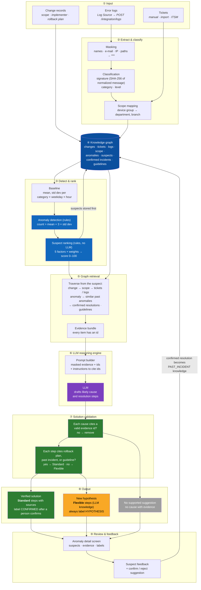
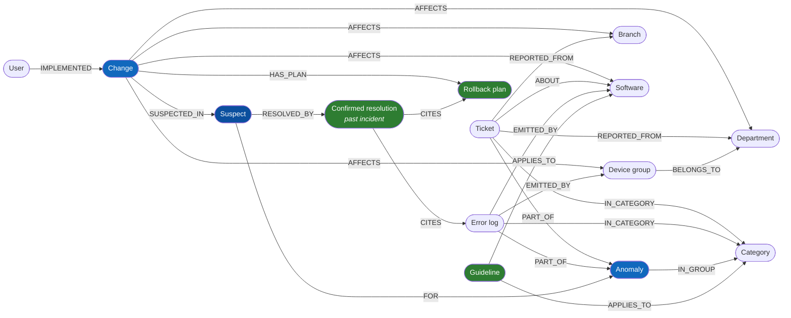
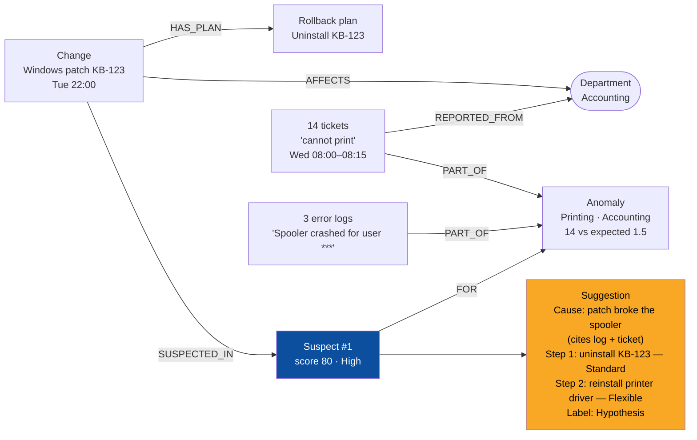

# AI Pipeline and Knowledge Graph

> **Status:** Target design · Implements F05, F06, F12, F13 · Runs in the Analysis Worker

The AI part answers two questions for every abnormal spike of tickets: **which recent change is the likely cause** (rule-based ranking) and **what should we do** (LLM reasoning over evidence). The LLM never decides the ranking, and every cause it states must point to evidence in the knowledge graph.

## 1. End-to-end flow — from input to output

| Step | What happens | Code (see [class diagrams](uml/01-class-diagrams.md)) | Data |
|---|---|---|---|
| ① Input | Logs, tickets, and changes arrive through the API or the UI | `integration`, `tickets`, `changes` modules | `error_logs`, `tickets`, `changes` |
| ② Extraction & classification | Mask sensitive data, compute signature and category, map device groups to department and branch | `ai/masking.py`, `LogService`, `LookupService` | `error_logs.signature`, `category_id` |
| ③ Detection & ranking | Compare counts with the baseline, create anomalies, score candidate changes | `BaselineService`, `AnomalyDetectionService`, `SuspectScorer` | `baseline_*`, `anomalies`, `suspects`, `suspect_factors` |
| ④ Knowledge graph | All entities and their links, stored relationally (section 2) | Repositories | All tables below |
| ⑤ Retrieval | Walk the graph from the suspect to collect evidence | `EvidenceCollector` | Read-only joins |
| ⑥ LLM reasoning | Send masked evidence with ids; receive cause and steps that cite ids | `SuggestionGenerator`, `LLMClient` | — |
| ⑦ Validation | Remove uncited causes; mark each step Standard or Flexible | `EvidenceValidator` | — |
| ⑧ Output | Store the suggestion with status and label | `SuggestionService` | `suggestions`, `suggestion_statements`, `statement_evidence` |
| ⑨ Feedback | Users judge suspects and confirm or reject suggestions; confirmed ones feed back into the graph | `anomalies`, `suggestions` modules | `suspect_feedback`, `suggestions.decision` |

## 2. Knowledge graph

The knowledge graph is the set of entities CIC knows about and the relations between them. In V1 it is **stored in PostgreSQL**: nodes are rows, edges are foreign keys and link tables. There is no separate graph database; retrieval is done with SQL joins (and recursive CTEs where a path is longer). A graph database can be introduced later behind the same `EvidenceCollector` if traversal becomes slow.

### Nodes and edges in the database

| Graph element | Stored as |
|---|---|
| Change, Ticket, Error log, Anomaly, Suspect, User | `changes`, `tickets`, `error_logs`, `anomalies`, `suspects`, `app_users` |
| Department, Branch, Software, Device group, Category | Lookup tables |
| Rollback plan | `changes.rollback_*` columns (1:1 with the change) |
| Confirmed resolution (past incident) | `suggestions` with `decision = CONFIRMED` |
| Guideline | `guidelines` |
| `AFFECTS` | `change_departments`, `change_branches`, `change_software`, `change_device_groups` |
| `REPORTED_FROM`, `ABOUT`, `IN_CATEGORY`, `EMITTED_BY` | Foreign keys on `tickets` and `error_logs` |
| `BELONGS_TO` | `device_groups.department_id`, `branch_id` |
| `PART_OF` | `anomaly_tickets`, `anomaly_logs` |
| `SUSPECTED_IN`, `FOR` | `suspects.change_id`, `suspects.anomaly_id` |
| `RESOLVED_BY`, `CITES` | `suggestions.suspect_id`, `statement_evidence` |
| `APPLIES_TO` | `guidelines.category_id`, `software_id` |

### Retrieval: what `EvidenceCollector` walks for one suspect

| # | Path | Evidence produced |
|---|---|---|
| 1 | Suspect → Anomaly → `PART_OF` ← Error logs (grouped by signature) | `LOG` items (masked messages, counts) |
| 2 | Suspect → Anomaly → `PART_OF` ← Tickets (sample) | `TICKET` items |
| 3 | Suspect → Change → `AFFECTS` → scope; Change → `HAS_PLAN` | `CHANGE` and `ROLLBACK_PLAN` items |
| 4 | Anomaly → same category and overlapping scope → past Anomalies → Suspect → `RESOLVED_BY` (confirmed) | `PAST_INCIDENT` items |
| 5 | Anomaly category / Change software → `APPLIES_TO` ← Guidelines | `GUIDELINE` items |

Limits keep the prompt small: at most 20 log groups, 10 tickets, 5 past incidents, and 5 guidelines, chosen by recency and scope overlap.

## 3. Worked example — the printer case

After an IT Manager confirms it, the suggestion is recorded as confirmed but stays **Hypothesis** because step 2 is Flexible. Next time printing tickets spike in Accounting after a patch, retrieval path 4 brings this resolution back as a `PAST_INCIDENT`, and step 1 becomes evidence for a Standard step.

## 4. Mapping to the original hybrid proposal

| Proposed stage | CIC design |
|---|---|
| Incoming Error Logs | ① Input (`ingestLogs`), together with tickets and changes |
| Error Extraction & Classification | ② Masking, signature, category, scope mapping |
| Knowledge Graph Retrieval | ④ + ⑤ Relational knowledge graph and `EvidenceCollector` |
| LLM Reasoning Engine | ⑥ `SuggestionGenerator` + `LLMClient` |
| Solution Validation | ⑦ `EvidenceValidator` |
| Verified Solution / New Hypothesis | ⑧ Standard (CONFIRMED after a person confirms) / Flexible (always HYPOTHESIS) |
| Notification + Feedback | ⑨ In-app review and feedback. Push notifications (e-mail, chat) are not in V1 scope |

Rules behind each stage: [BR-008, BR-010–BR-017](../requirements/business-rules.md). Measurable targets: [NFR-AI-001–004, NFR-PRIV-001–002](../requirements/non-functional-requirements.md).
