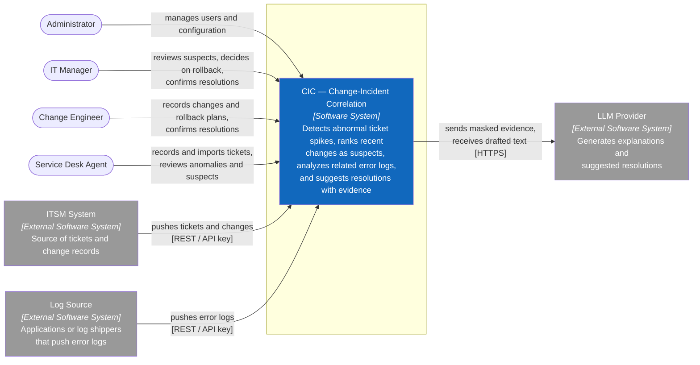

# C1 — System Context

> **Purpose:** show who uses CIC, which external systems it talks to, and what it is responsible for, without implementation technology.

## System Boundary

CIC is responsible for login and authorization, change and ticket records, ticket import, error-log intake, baselines, anomaly detection, suspect ranking, AI analysis and suggested resolutions, feedback, audit logs, configuration, user management, and personal profiles.

Outside the boundary:

- **ITSM System** keeps owning tickets and changes; CIC only receives copies.
- **Log Source** pushes error logs; CIC does not collect logs from servers.
- **LLM Provider** only writes text from the masked evidence CIC sends; it never computes the suspicion score and never receives unmasked log data.
- CIC never executes a rollback or fix on real infrastructure.

## People and External Systems

| Element | Type | Interaction |
|---|---|---|
| Administrator | Person | Full access, users, configuration |
| IT Manager | Person | Reviews suspects and evidence, decides on rollback, confirms or rejects resolutions, reads the audit log |
| Change Engineer | Person | Records changes and rollback plans (own records), confirms or rejects resolutions |
| Service Desk Agent | Person | Records and imports tickets, reviews anomalies, suspects, logs, and suggestions |
| ITSM System | External system | Pushes tickets and changes through the integration API |
| Log Source | External system | Pushes error logs through the integration API |
| LLM Provider | External system | Receives masked evidence and returns drafted explanations and resolutions |

**Next:** zoom into the Software System → [C2 — Container](02-container.md).

**Sources of truth:** `docs/01-scope.md`, `docs/03-use-cases.md`, `docs/api/openapi.yaml`.
