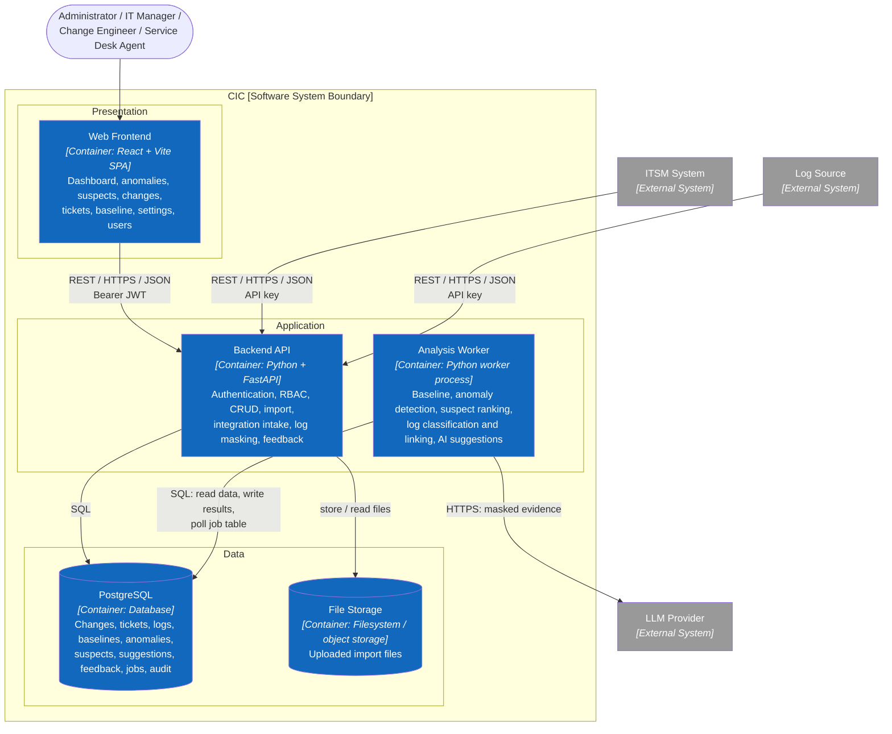

# C2 — Container

> **Purpose:** show the runtime units that make up CIC and how they communicate.

## Responsibilities

| Container | Technology (proposed) | Responsibility | Status |
|---|---|---|---|
| Web Frontend | React, Vite | UI, route and role guards, charts, forms, tables; hides controls a role cannot use | Not started |
| Backend API | Python, FastAPI, Pydantic, SQLAlchemy, REST/JSON | Trust boundary: authentication, RBAC, own-record rule, validation, CRUD, import, integration intake, masking on receipt, feedback and confirmation | Not started |
| Analysis Worker | Python worker process (same codebase as the API), pandas/NumPy, LLM SDK | Scheduled and on-demand jobs: baseline, anomaly detection, suspect ranking, log classification and linking, evidence collection, LLM calls, evidence validation | Not started |
| PostgreSQL | PostgreSQL | Persistent data, job table, audit log | Not started |
| File Storage | Filesystem outside the web root (object storage later if needed) | Import files addressed by generated keys | Not started |

Python and FastAPI are chosen for the whole backend because the AI part (log analysis, LLM calls, baseline and anomaly statistics) has the strongest library support in Python. The Backend API and the Analysis Worker live in one Python codebase and share the domain models and the database layer; they are deployed as two processes from the same image. FastAPI also generates OpenAPI from code, which can be checked against `docs/api/openapi.yaml`.

## Architecture Rules

- The Web Frontend never talks to the database, the worker, or the LLM directly; the Backend API is the only entry point.
- RBAC and the own-record rule are enforced in the Backend API; the frontend only hides controls.
- The Backend API and the Analysis Worker communicate through PostgreSQL (a job table), not a message broker. A recompute request writes a job row; the worker polls it. This keeps V1 to two deployable services and one database.
- Sensitive data in logs is masked by the Backend API on receipt, so unmasked data is never stored for analysis and never reaches the LLM.
- Only the Analysis Worker calls the LLM Provider. The suspicion score is computed before and independently of the LLM.
- External systems authenticate with an API key; users authenticate with a JWT.

**Next:** zoom into the application containers → [C3 — Component](03-component.md).
