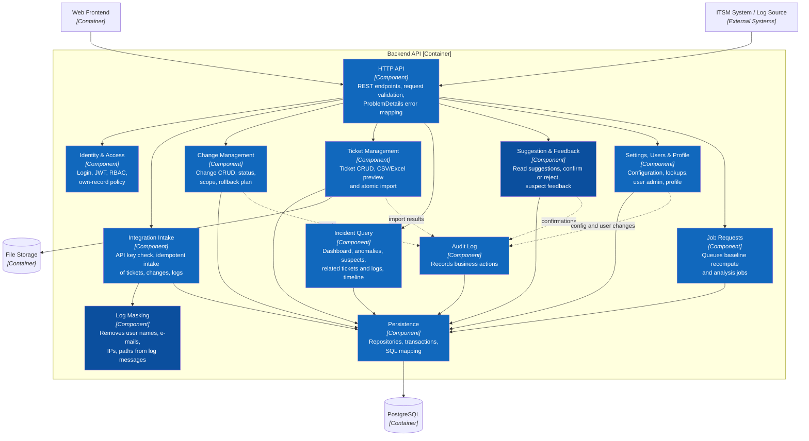
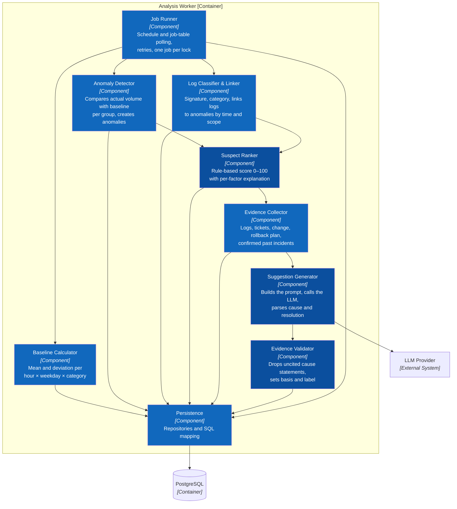

# C3 — Component

> **Purpose:** show how the two application containers, Backend API and Analysis Worker, are decomposed.

## C3.1 Backend API

## C3.2 Analysis Worker

## Component catalog

| Container | Component | Responsibility | Features / use cases |
|---|---|---|---|
| Backend API | HTTP API | Endpoints from `docs/api/openapi.yaml`, validation, error mapping | All |
| Backend API | Identity & Access | Login, JWT, RBAC, own-record rule for changes | F01 · UC01, UC02 |
| Backend API | Integration Intake | API-key auth, idempotent intake by `externalId` | F03, F13 · UC10, UC22 |
| Backend API | Log Masking | Masks sensitive data before a log is stored | F13.2 |
| Backend API | Change Management | Change CRUD and status, scope, rollback plan | F02 · UC04–UC06 |
| Backend API | Ticket Management | Ticket CRUD, import preview and atomic import | F03 · UC07–UC09 |
| Backend API | Incident Query | Dashboard, anomalies, suspects, related tickets and logs, timeline | F07 · UC03, UC14, UC23 |
| Backend API | Suggestion & Feedback | Read suggestions, confirm or reject, suspect feedback | F08, F12 · UC15, UC20, UC21 |
| Backend API | Settings, Users & Profile | Configuration, lookups, users, profile | F09, F11 · UC17–UC19 |
| Backend API | Job Requests | Writes recompute and analysis jobs to the job table | F04 · UC12 |
| Backend API | Audit Log | Records business actions | F10 · UC16 |
| Analysis Worker | Job Runner | Runs scheduled and requested jobs, locking, retries | F04, F05 |
| Analysis Worker | Baseline Calculator | Computes baselines, excludes incident periods | F04 · UC11, UC12 |
| Analysis Worker | Anomaly Detector | Creates anomalies when volume exceeds the threshold | F05 · UC13 |
| Analysis Worker | Log Classifier & Linker | Signature, category, links logs to anomalies | F13.3, F13.4 |
| Analysis Worker | Suspect Ranker | Rule-based score and factor explanations | F06 · UC13 |
| Analysis Worker | Evidence Collector | Gathers evidence for each suspect | F12.1 |
| Analysis Worker | Suggestion Generator | Calls the LLM with masked evidence | F12.2, F13.5 |
| Analysis Worker | Evidence Validator | Removes uncited cause statements; sets `basis` and `label` | F12.3–F12.5 |

## Dependency Flow

- **Backend API:** HTTP API → feature components → Persistence → PostgreSQL. Feature components send events to Audit Log; they do not call each other except through Persistence.
- **Analysis Worker:** Job Runner → Baseline / Anomaly Detector / Log Classifier → Suspect Ranker → Evidence Collector → Suggestion Generator → Evidence Validator → Persistence.
- The Suspect Ranker finishes before the Suggestion Generator runs, so the score never depends on the LLM.
- If the LLM call fails, suspects and scores are still stored; the suggestion is retried later and the screen shows "No supported suggestion" until then.
