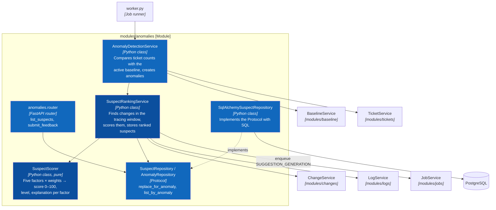
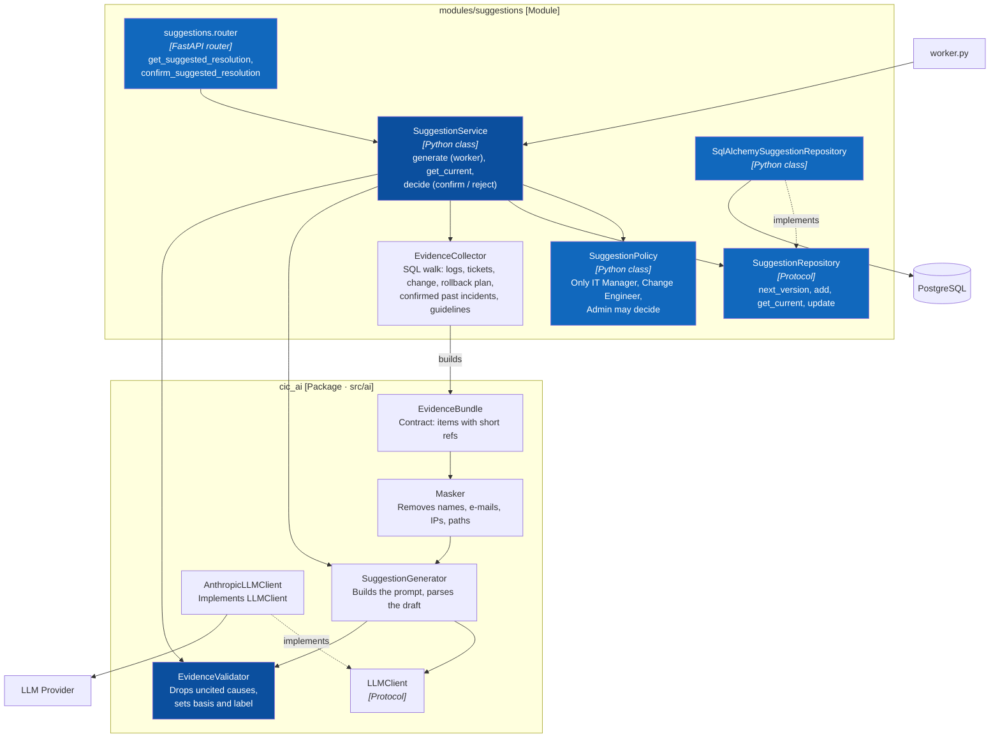

# C4 Level 4 — Code — Two Core Features

> **Status:** Target design · Python 3.12, FastAPI, SQLAlchemy 2, Pydantic 2

The two features that answer the core question "which recent change caused this spike, and what should we do?":

- **L4.1 Suspect Ranking** — `modules/anomalies` (rule-based, no LLM).
- **L4.2 Suggested Resolution** — `modules/suggestions` + the [`cic_ai` package](../ai-package.md) (LLM with evidence validation).

Both run in the Analysis Worker; users read the results through the Backend API.

## L4.1 Suspect Ranking

## L4.2 Suggested Resolution

## Shared rules for both features

- The suspicion score is final before `cic_ai` runs; `SuggestionService.generate` reads suspects, it never changes scores.
- `SuspectScorer` and `EvidenceValidator` are pure classes (no database, no network) so they are unit-tested directly.
- Services depend on Protocols; `core/container.py` binds the SQLAlchemy repositories and `cic_ai.AnthropicLLMClient`. Tests use `tests/fakes/` and `cic_ai.StubLLMClient`.
- If the LLM call fails, the suggestion is stored with status `FAILED`, the job is retried up to `max_attempts`, and the screen shows "No supported suggestion".
- Every decision (confirm / reject) and every feedback is written to the audit log through `AuditService`.
