# C4 Model — CIC

> **Status:** Target design · **Audience:** developers, reviewers, and mentors

The documentation proceeds from the outside in. Every node has a **name**, **type** (`Person`, `Software System`, `Container`, `Component`), technology where relevant, and a short description.

```mermaid
flowchart LR
    C1["C1 · System Context<br/><small>Who uses CIC and what does it talk to?</small>"]
    C2["C2 · Container<br/><small>What runtime units make up CIC?</small>"]
    C3["C3 · Component<br/><small>How are the Backend API and Analysis Worker decomposed?</small>"]
    C4["C4 · Code<br/><small>How are the two core features organized?</small>"]
    C1 -->|"zoom into CIC"| C2
    C2 -->|"zoom into Backend API and Analysis Worker"| C3
    C3 -->|"zoom into ranking and suggestions"| C4
    style C4 fill:#1168bd,color:#fff,stroke:#0b4884
    style C1 fill:#1168bd,color:#fff,stroke:#0b4884
    style C2 fill:#1168bd,color:#fff,stroke:#0b4884
    style C3 fill:#1168bd,color:#fff,stroke:#0b4884
```

| Level | Document | Scope |
|---|---|---|
| C1 | [System Context](01-system-context.md) | Four roles, ITSM System, Log Source, LLM Provider |
| C2 | [Container](02-container.md) | Web Frontend, Backend API, Analysis Worker, PostgreSQL, File Storage |
| C3 | [Component](03-component.md) | Components inside the Backend API and the Analysis Worker |
| C4 | [Code — two core features](04-code.md) | Python classes for Suspect Ranking and Suggested Resolution |

The AI flow from input to output and the knowledge graph are described in [AI Pipeline and Knowledge Graph](../ai-pipeline.md).

## Implementation Status

No container is implemented yet. The diagrams describe the **target architecture**; the technologies in C2 are proposals.
