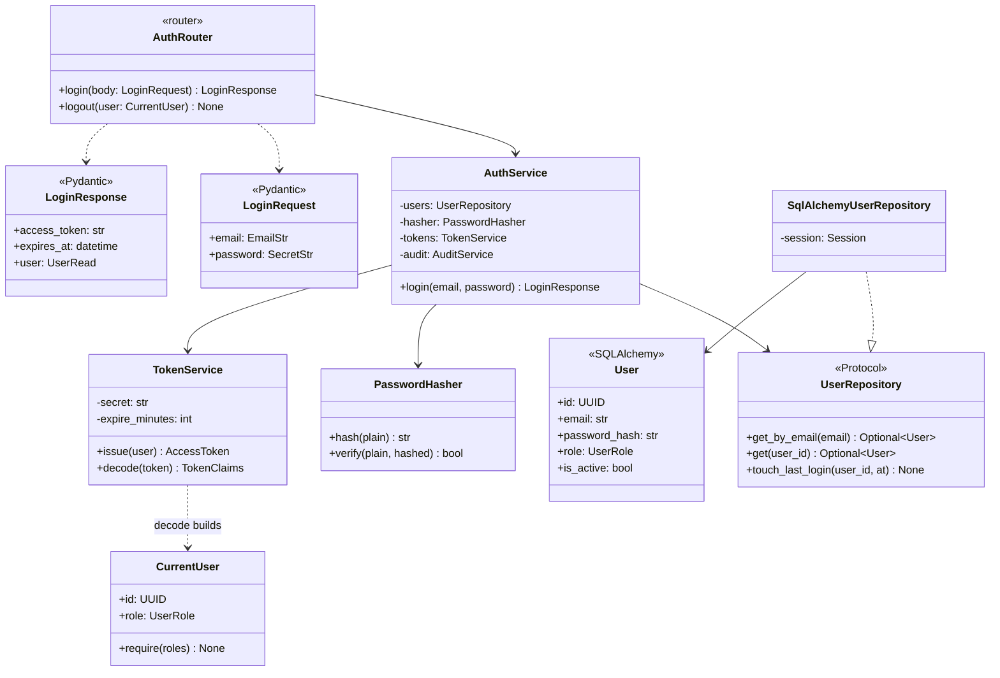
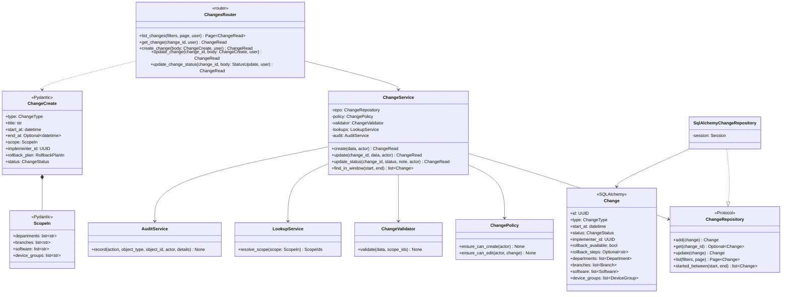
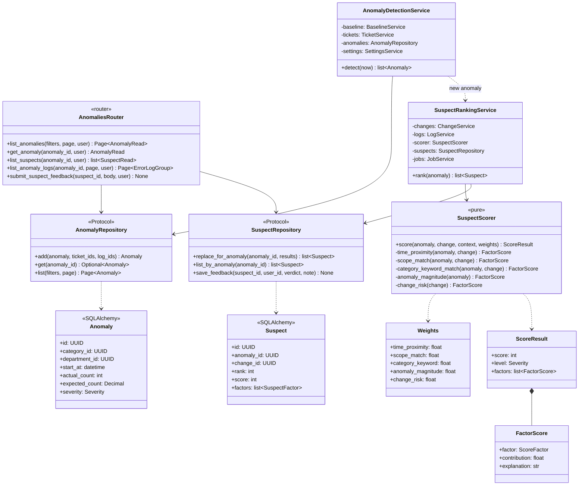
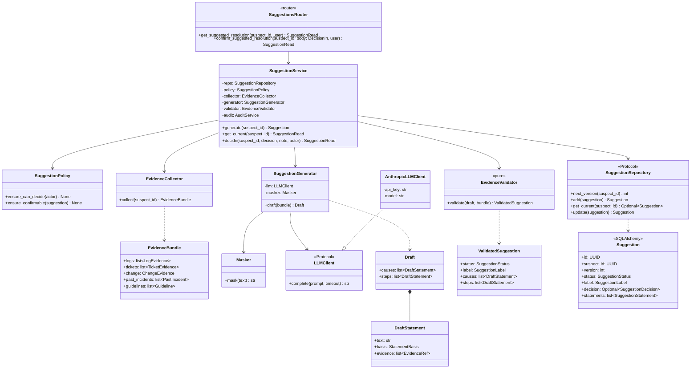

# Class Diagrams — Authentication, Changes, Suspect Ranking, Suggested Resolution

> **Status:** Target design · Python 3.12, FastAPI, SQLAlchemy 2, Pydantic 2
>
> Names follow [Target Folder Structure](../../07-folder-structure.md); tables follow [cic.sql](../../../src/database/cic.sql); operations follow [openapi.yaml](../../api/openapi.yaml).

Stereotypes: `<<router>>` FastAPI router functions · `<<Pydantic>>` request/response schema · `<<SQLAlchemy>>` table model · `<<Protocol>>` interface injected by `core/container.py`.

## 1. Authentication — `modules/auth`, `modules/users`, `core/security`

Rules: an inactive user cannot log in; the same error is returned for an unknown e-mail and a wrong password; the password hash never leaves `AuthService`.

## 2. Change Management — `modules/changes`

Rules: `ChangePolicy.ensure_can_edit` lets a Change Engineer edit only changes where they are the implementer; `ChangeValidator` requires at least one scope value, `end_at ≥ start_at`, and steps when a rollback plan is available. Scope names are resolved to lookup ids by `LookupService` (module `settings`).

## 3. Suspect Ranking — `modules/anomalies`

Rules: the score is `round(100 × Σ(weightᵢ × factorᵢ) / Σ weightᵢ)` with each factor in [0, 1], capped at 39 when scope and keyword match are both 0 (factor formulas: [09-algorithms.md](../../09-algorithms.md#4-suspect-ranking)); level is High ≥ 70, Medium ≥ 40, otherwise Low; ranks are 1..n by descending score; a new ranking replaces the old suspects of that anomaly in one transaction and enqueues one `SUGGESTION_GENERATION` job per suspect.

## 4. Suggested Resolution — `modules/suggestions` + `cic_ai` (`src/ai`)

`EvidenceValidator` rules:

| Input | Result |
|---|---|
| Cause statement with no evidence, or evidence that is not in the bundle | Removed |
| No cause statement left | `status = NO_SUPPORT` (screen: "No supported suggestion") |
| Step citing a rollback plan, past incident, or guideline from the bundle | `basis = STANDARD` |
| Step without valid evidence | `basis = LLM_KNOWLEDGE` |
| Any statement | `label = HYPOTHESIS` at creation; only `SuggestionService.decide` sets `CONFIRMED`, and only when every statement is `STANDARD` |

## 5. Shared enums

| Enum | Values |
|---|---|
| `UserRole` | ADMIN, IT_MANAGER, CHANGE_ENGINEER, AGENT |
| `ScoreFactor` | TIME_PROXIMITY, SCOPE_MATCH, CATEGORY_KEYWORD_MATCH, ANOMALY_MAGNITUDE, CHANGE_RISK |
| `Severity` | HIGH, MEDIUM, LOW |
| `StatementBasis` | STANDARD, LLM_KNOWLEDGE |
| `SuggestionStatus` | PENDING, READY, NO_SUPPORT, FAILED |
| `SuggestionLabel` | CONFIRMED, HYPOTHESIS |

Python enums mirror the PostgreSQL enums in `cic.sql` one-to-one.

## 6. Mapping boundaries

- `router` ↔ Pydantic schemas only; never SQLAlchemy models.
- `service` ↔ Protocols and plain dataclasses; maps models to schemas before returning.
- `repository` ↔ SQLAlchemy models and the session; commits are owned by the request (API) or the job (worker).
