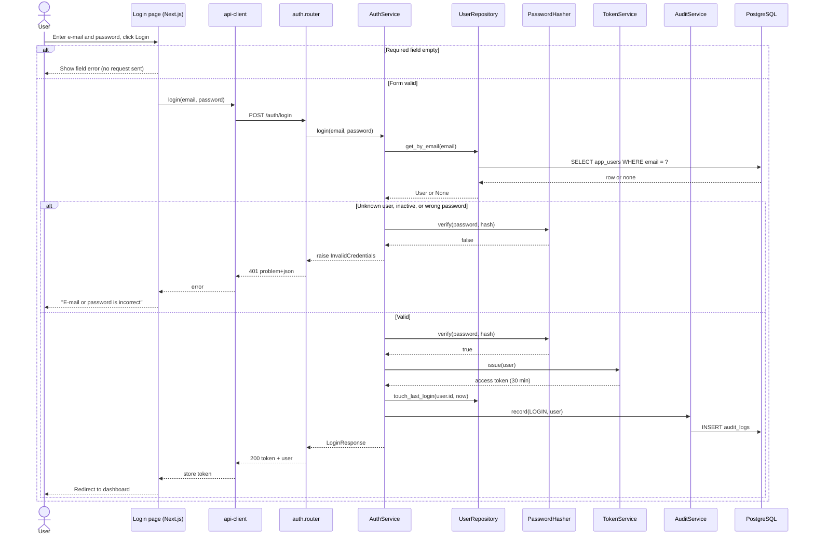
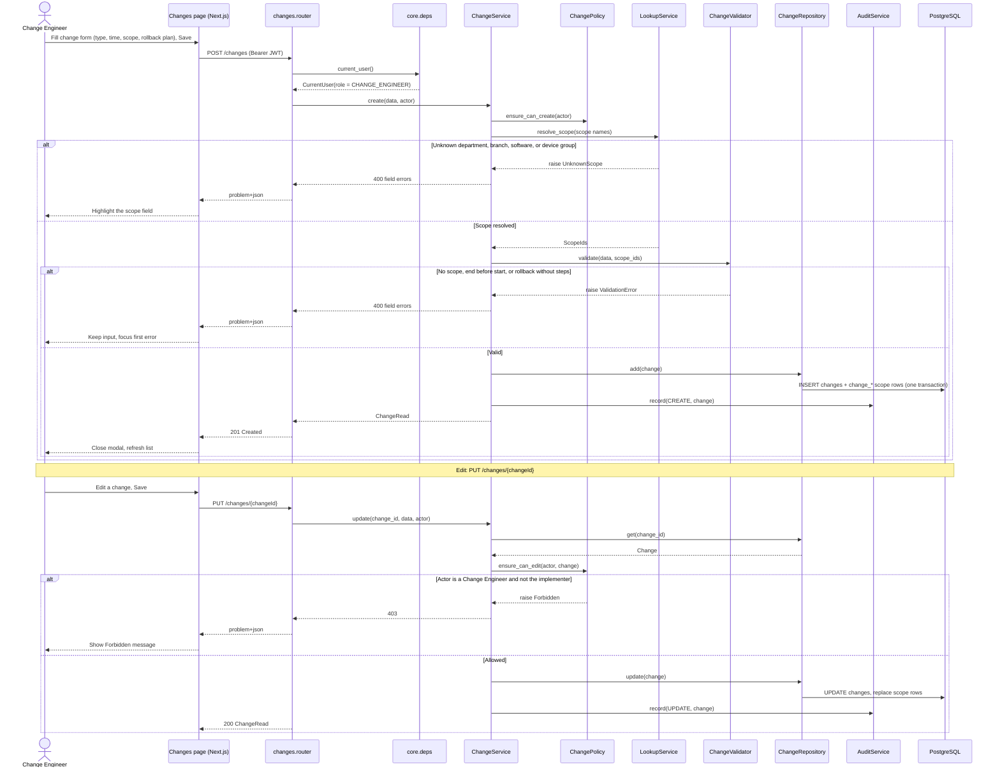
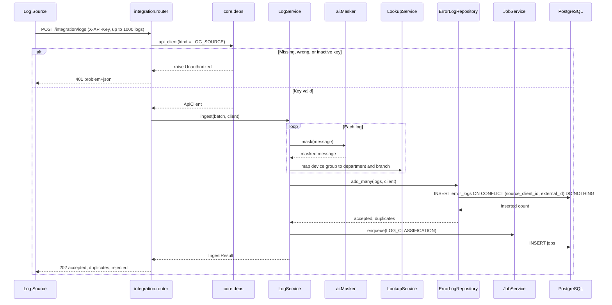
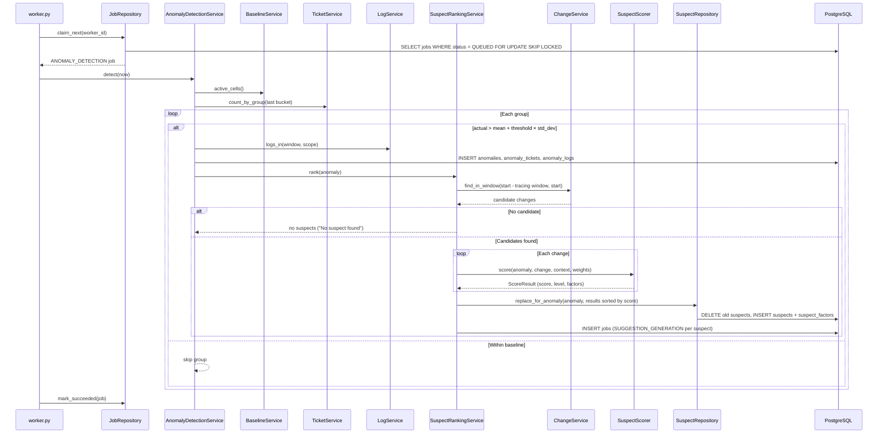
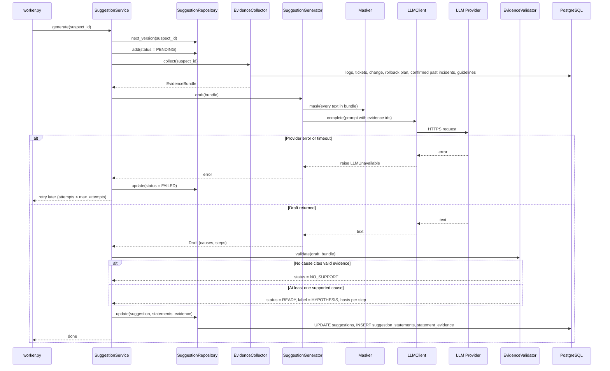
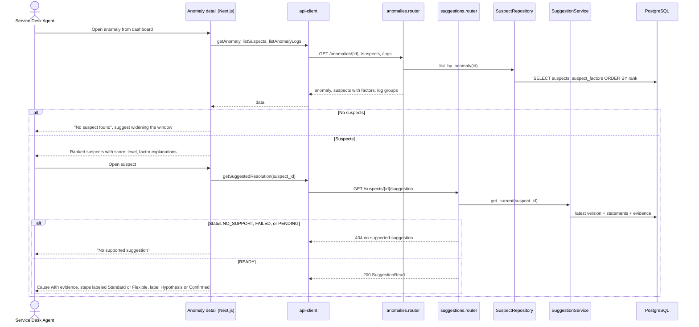
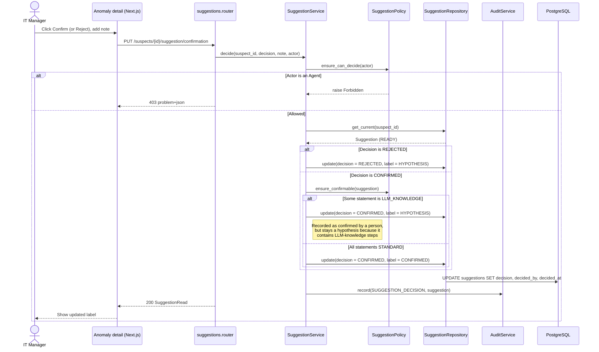

# Sequence Diagrams — CIC V1

> **Status:** Target design · Endpoints follow [openapi.yaml](../../api/openapi.yaml)

Pattern for user flows: **Actor → Next.js page → api-client → FastAPI router → Service → Repository → PostgreSQL**. Background flows start at `worker.py`. Solid arrows are requests, dashed arrows are responses; `alt` shows mutually exclusive outcomes.

| # | Flow | Trigger | Use case / story |
|---|---|---|---|
| 1 | Login | `POST /auth/login` | UC01 · US01 |
| 2 | Create and edit a change | `POST /changes`, `PUT /changes/{changeId}` | UC05, UC06 · US04, US05 |
| 3 | Ingest error logs | `POST /integration/logs` | UC22 · US22 |
| 4 | Detect anomaly and rank suspects | Scheduled job | UC13 · US12 |
| 5 | Generate suggested resolution | `SUGGESTION_GENERATION` job | UC13, UC20 · US20 |
| 6 | Review anomaly, suspects, and suggestion | `GET /anomalies/{id}/suspects`, `GET /suspects/{id}/suggestion` | UC14, UC20, UC23 · US12, US20, US23 |
| 7 | Confirm or reject a suggestion | `PUT /suspects/{id}/suggestion/confirmation` | UC21 · US21 |

## 1. Login — `POST /api/v1/auth/login`

## 2. Create and edit a change — `POST /changes`, `PUT /changes/{changeId}`

## 3. Ingest error logs — `POST /api/v1/integration/logs`

The raw message is never stored: masking happens before the insert.

## 4. Detect anomaly and rank suspects — scheduled job

The ranking finishes and is committed before any LLM call.

## 5. Generate suggested resolution — `SUGGESTION_GENERATION` job

## 6. Review anomaly, suspects, and suggestion

The Agent sees no confirm button: the UI hides it, and the API would reject it (flow 7).

## 7. Confirm or reject a suggestion — `PUT /suspects/{suspectId}/suggestion/confirmation`

A confirmed suggestion becomes `PAST_INCIDENT` evidence for later similar anomalies (flow 5).

## 8. Common error conventions

| Situation | Status | Where it is decided |
|---|---|---|
| Field validation fails | 400 with `errors` per field | Pydantic schema or `*Validator` |
| Missing or invalid JWT / API key | 401 | `core.deps` |
| Role or own-record rule fails | 403 | `*Policy` |
| Resource or supported suggestion not found | 404 | Service |
| Duplicate e-mail | 409 | `UserService` (unique constraint) |
| Unexpected error | 500 with `traceId` only | `core.errors` |
