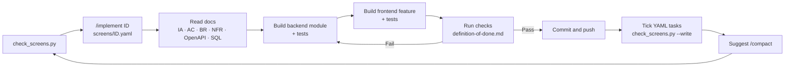

# Project management — CIC V1

This folder tracks **how** CIC V1 gets built. [screens/](screens/README.md) is the single source of truth for build work; everything else here either holds data the YAML does not (goals, story text, decisions, risks) or is generated from it. **What** CIC must do lives in [`docs/`](../docs); rules for coding agents live in [`CLAUDE.md`](../CLAUDE.md).

| File | Purpose | Updated when |
|---|---|---|
| [screens/](screens/README.md) | One YAML per screen (feature + modules) or slice, same schema for all: route, roles, stories, AC, rules, NFR, API, tables, components, hooks, states, tasks, status | The item is planned, started, or finished |
| [tracker.md](tracker.md) | **Generated** by `python project/tools/check_screens.py --write`: build order, status, task progress, story coverage | Never by hand |
| [tools/check_screens.py](tools/check_screens.py) | Validates every YAML against docs, OpenAPI, cic.sql, folder structure; checks coverage and dependencies | Run before and after every item; also run automatically by the hooks in `.claude/settings.json` ([claude_hook.py](tools/claude_hook.py)) |
| [roadmap.md](roadmap.md) | Milestone goals and exit criteria | A milestone changes scope |
| [backlog.md](backlog.md) | Story text, feature, priority, acceptance id | A story changes |
| [definition-of-done.md](definition-of-done.md) | Checklist a screen and a milestone must pass | The quality bar changes |
| [decisions.md](decisions.md) | Decision log with reasons | A technical or product decision is made |
| [risks-and-questions.md](risks-and-questions.md) | Risks, open questions, doc inconsistencies | A risk or question appears or is resolved |
| [sprints/](sprints/README.md) | Sprint template and sprint plans | A sprint is planned or reviewed |

## Run a work item

Step-by-step guide (Vietnamese): [WORKFLOW.md](WORKFLOW.md).

Use the project command in Claude Code:

```text
/implement SCR-01
```

It runs the sync check, reads `screens/<ID>.yaml`, checks open questions, decisions, backlog, and the definition of done, then the linked docs, and only then writes code, runs the checks, ticks the YAML tasks, regenerates the tracker, commits, and pushes. `/implement` with no ID takes the next item that is ready. Source: [.claude/skills/implement/SKILL.md](../.claude/skills/implement/SKILL.md).

## Status legend

| Mark | Meaning |
|---|---|
| ⬜ | Not started |
| 🟨 | In progress |
| 🟦 | In review (code complete, checks running or review pending) |
| ✅ | Done — passes [definition-of-done.md](definition-of-done.md) |
| ⛔ | Blocked — reason in [risks-and-questions.md](risks-and-questions.md) |

## Working loop



## Current status

- Design phase: **complete** (scope, features, use cases, INVEST backlog, IA, acceptance criteria, business rules, NFRs, algorithms, C4, data model, OpenAPI, folder structure, class and sequence diagrams).
- Dependency setup: **complete** (`src/backend/requirements*.txt`, `src/frontend/package.json` with Tailwind CSS 4, shadcn/ui, TanStack Query).
- Implementation: **not started** — next item is [PLT-1](screens/PLT-1.yaml); the AI track [AI-1](screens/AI-1.yaml) … AI-4 can run in parallel.
- AI package: **planned** — design in [ai-package.md](../docs/architecture/ai-package.md), work items [AI-1](screens/AI-1.yaml) … [AI-4](screens/AI-4.yaml).
