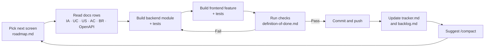

# Project management — CIC V1

This folder tracks **how** CIC V1 gets built: milestones, backlog, progress per screen, decisions, and risks. **What** CIC must do lives in [`docs/`](../docs); rules for coding agents live in [`CLAUDE.md`](../CLAUDE.md).

| File | Purpose | Updated when |
|---|---|---|
| [roadmap.md](roadmap.md) | Milestones M0–M6 in build order, with exit criteria | A milestone starts, finishes, or changes scope |
| [backlog.md](backlog.md) | All 23 user stories mapped to feature, priority, screen, modules, acceptance criteria, milestone | A story changes status |
| [tracker.md](tracker.md) | Progress per screen: backend, frontend, tests, accessibility, done | A screen moves forward |
| [definition-of-done.md](definition-of-done.md) | Checklist a screen and a milestone must pass | The quality bar changes |
| [decisions.md](decisions.md) | Decision log with reasons | A technical or product decision is made |
| [risks-and-questions.md](risks-and-questions.md) | Risks, open questions, doc inconsistencies | A risk or question appears or is resolved |
| [sprints/](sprints/README.md) | Sprint template and sprint plans | A sprint is planned or reviewed |

## Status legend

| Mark | Meaning |
|---|---|
| ⬜ | Not started |
| 🟨 | In progress |
| 🟦 | In review (code complete, checks running or review pending) |
| ✅ | Done — passes [definition-of-done.md](definition-of-done.md) |
| ⛔ | Blocked — reason in [risks-and-questions.md](risks-and-questions.md) |

## Working loop

## Current status

- Design phase: **complete** (scope, features, use cases, INVEST backlog, IA, acceptance criteria, business rules, NFRs, algorithms, C4, data model, OpenAPI, folder structure, class and sequence diagrams).
- Dependency setup: **complete** (`src/backend/requirements*.txt`, `src/frontend/package.json` with Tailwind CSS 4, shadcn/ui, TanStack Query).
- Implementation: **not started** — next milestone is [M0 Platform](roadmap.md#m0--platform).
