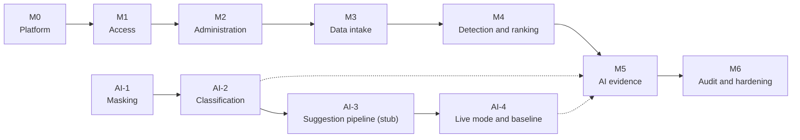

# Roadmap — CIC V1

Milestones follow the dependency chain in the [INVEST backlog](../docs/05-invest-requirements.md): access, then reference data, then data intake, then detection, then AI evidence. The work items of each milestone live in [screens/](screens/README.md) (one YAML per screen or slice) and are listed in build order in [tracker.md](tracker.md). No dates are fixed yet; see [Q-01](risks-and-questions.md#open-questions).

| Milestone | Goal | Exit |
|---|---|---|
| M0 Platform | Shared backend core, database, frontend shell, CI — only what SCR-01 needs | API and web start locally; health is green; CI passes |
| M1 Access | Every role logs in and out, sees only permitted navigation, maintains its profile | AC-UC01, AC-UC02, AC-UC19 pass; 5 failed logins return `429` |
| M2 Administration | Administrators manage users and settings; lookups available | AC-UC17, AC-UC18 pass; BR-019 ranges enforced |
| M3 Data intake | Changes and tickets enter through UI, import, and ITSM API | AC-UC04–AC-UC10 pass; imports atomic; integration idempotent |
| M4 Detection and ranking | Spikes detected against the baseline; changes ranked as explained suspects | The printer example of [09-algorithms.md §5](../docs/09-algorithms.md#5-worked-example--the-printer-case) reproduces end to end |
| M5 AI evidence | Error logs and evidence-grounded suggestions on the anomaly detail | AC-UC20–AC-UC23 pass; an LLM outage leaves ranking untouched |
| M6 Audit and hardening | Audit screen; every NFR verified | All verifications in [non-functional-requirements.md](../docs/requirements/non-functional-requirements.md) pass |
| AI track | `cic_ai` built and measured from the terminal in parallel with M0–M4 | Stub bars pass in CI; live baseline recorded ([ai-package.md](../docs/architecture/ai-package.md)) |
