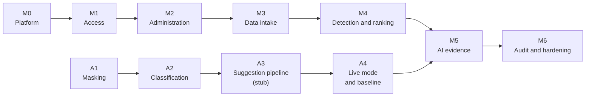

# Roadmap — CIC V1

Detailed work items for every milestone: [plans/](plans/README.md). Milestones follow the dependency chain in the [INVEST backlog](../docs/05-invest-requirements.md): access first, then reference data, then data intake, then detection, then AI evidence. Each milestone is built screen by screen as required by [`CLAUDE.md`](../CLAUDE.md). No dates are fixed yet; see [risks-and-questions.md](risks-and-questions.md#open-questions).

| Milestone | Screens | Stories | Status |
|---|---|---|---|
| [M0 Platform](#m0--platform) | — | — | ⬜ |
| [M1 Access](#m1--access) | SCR-01, SCR-90, SCR-80 | US01, US02, US18 | ⬜ |
| [M2 Administration](#m2--administration) | SCR-70, SCR-60 | US17, US16 | ⬜ |
| [M3 Data intake](#m3--data-intake) | SCR-20–22, SCR-30, SCR-31 | US04–US09, US19 | ⬜ |
| [M4 Detection and ranking](#m4--detection-and-ranking) | SCR-40, SCR-10, SCR-11, SCR-02 | US10–US14, US03 | ⬜ |
| [M5 AI evidence](#m5--ai-evidence) | SCR-11 (logs and suggestion tabs) | US22, US23, US20, US21 | ⬜ |
| [M6 Audit and hardening](#m6--audit-and-hardening) | SCR-50 | US15 | ⬜ |
| [AI track A1–A4](#ai-track) | — (terminal only) | supports US20, US22, US23 | ⬜ |

## M0 — Platform

Only the shared code that SCR-01 needs; nothing speculative.

- Backend: `app/main.py`, `api_router.py`, `core/config.py` (pydantic-settings), `core/database.py`, `core/errors.py` (problem+json), `core/security.py`, `core/deps.py`, `core/container.py`, `/health`, structured JSON logs with trace id (NFR-OBS-001).
- Database: Alembic baseline migration from `src/database/cic.sql`; seed script for one Administrator and lookup data.
- Frontend: `lib/api-client.ts` (JWT, 401/403, problem+json), `lib/api-types.ts` from OpenAPI, `proxy.ts`, workspace shell (sidebar and topbar), shadcn base components.
- Tooling: CI running format, lint, type check, tests, OpenAPI validation, migrations (NFR-MAINT-002); `Dockerfile` for `api` and `worker`.

**Exit:** `api` and `web` start locally, `/health` is green, CI passes on an empty feature set.

## M1 — Access

| Order | Screen | Stories | Backend modules |
|---|---|---|---|
| 1 | SCR-01 Login + shell logout | US01, US02 | `auth`, `users` (read), `audit` (write service only) |
| 2 | SCR-90 Forbidden | — | — |
| 3 | SCR-80 Profile | US18 | `users` |

Covers BR-001, BR-021 (login/logout audit), NFR-SEC-001–003.
**Exit:** every role can log in, see only permitted navigation, change password; 5 failed logins return `429`.

## M2 — Administration

| Order | Screen | Stories | Backend modules |
|---|---|---|---|
| 1 | SCR-70 Users | US17 | `users` |
| 2 | SCR-60 Settings | US16 | `settings` (settings + lookups) |

Lookups (categories, departments, branches, software, device groups) come before changes and tickets because both depend on them. Covers BR-019.
**Exit:** Administrator manages users and all settings tabs; ranges are rejected outside BR-019.

## M3 — Data intake

| Order | Screen | Stories | Backend modules |
|---|---|---|---|
| 1 | SCR-20–22 Changes | US06, US04, US05 | `changes` |
| 2 | SCR-30 Tickets | US09, US07 | `tickets` |
| 3 | SCR-31 Ticket import | US08 | `tickets`, `jobs` |
| 4 | ITSM integration (no screen) | US19 | `integration` |

Covers BR-002–BR-007, NFR-IMPORT-001, NFR-PERF-004, NFR-SEC-006.
**Exit:** changes and tickets enter through UI, import, and API; imports are atomic; integration is idempotent.

## M4 — Detection and ranking

| Order | Screen | Stories | Backend modules |
|---|---|---|---|
| 1 | SCR-40 Baseline | US10, US11 | `baseline`, `jobs`, worker |
| 2 | Detection and ranking (worker) | US12 | `anomalies`, `jobs`, worker |
| 3 | SCR-10 Anomaly list | US12 | `anomalies` |
| 4 | SCR-11 Anomaly detail — suspects | US12, US13, US14 | `anomalies` |
| 5 | SCR-02 Dashboard | US03 | `dashboard` |

Follows [09-algorithms.md](../docs/09-algorithms.md). Covers BR-009–BR-012, NFR-TIME-001–002, NFR-REL-002.
**Exit:** the printer worked example in 09-algorithms.md §5 reproduces end to end with seeded data.

## M5 — AI evidence

| Order | Screen | Stories | Backend modules |
|---|---|---|---|
| 1 | Log intake (no screen) | US22 | `logs`, `integration`, `cic_ai.masking`, `cic_ai.classification` |
| 2 | SCR-11 Related logs tab | US23 | `anomalies`, `logs` |
| 3 | SCR-11 Suggestion panel | US20 | `suggestions` (`EvidenceCollector`), `cic_ai.pipeline`, worker |
| 4 | SCR-11 Confirm / reject | US21 | `suggestions` |

Follows [ai-pipeline.md](../docs/architecture/ai-pipeline.md). Starts only after AI track A1–A4 is done; this is phase A5 of the [AI plan](plans/ai-package.md). Covers BR-008, BR-013–BR-018, NFR-PRIV-001–002, NFR-AI-001–003, NFR-TIME-003.
**Exit:** suggestions cite evidence, flexible steps stay Hypothesis, an LLM outage leaves ranking untouched.

## M6 — Audit and hardening

| Order | Item | Stories |
|---|---|---|
| 1 | SCR-50 Audit log | US15 |
| 2 | Performance and capacity tests (NFR-PERF-*, NFR-CAP-*) | — |
| 3 | Security tests (NFR-SEC-*, RBAC matrix) | — |
| 4 | Accessibility audit on every screen (NFR-ACC-001) | — |
| 5 | Backup/restore and retention jobs (NFR-BCP-001, NFR-RET-001) | — |

**Exit:** every NFR verification in [non-functional-requirements.md](../docs/requirements/non-functional-requirements.md) passes under the reference workload.

## AI track

The `cic_ai` package is built and measured from the terminal, in parallel with M0–M4, and joins the backend in M5. Plan: [plans/ai-package.md](plans/ai-package.md). Design: [ai-package.md](../docs/architecture/ai-package.md).

| Phase | Delivers | Exit |
|---|---|---|
| A1 Masking | Package skeleton, `Masker`, corpus ≥ 500 lines, `cic-ai mask`, `cic-ai eval masking` | M-MASK-01 = 1.00, M-MASK-02 = 0 |
| A2 Classification | `LogClassifier`, dataset, `cic-ai classify`, `cic-ai eval classification` | M-CLS bars pass |
| A3 Suggestion pipeline (stub) | Evidence contract, prompt, parser, validator, stub client, ≥ 30 cases, CI job | All stub bars pass in CI |
| A4 Live mode and baseline | `AnthropicLLMClient`, pricing, latency and cost metrics, first live baseline | Baseline recorded in decisions.md |
